# Práctica de Laboratorio: TaskManager
## Documentación de errores y depuración

En esta práctica se revisó el funcionamiento de la aplicación TaskManager mediante herramientas de depuración de Android Studio. Se identificaron seis errores relacionados con las fechas, el modo de edición, el calendario, el registro de Activities, los identificadores de tareas y el RecyclerView.

A continuación, se documenta cada error, el proceso de revisión, la solución aplicada y las evidencias correspondientes.

---

## Error 1. Formato incorrecto de fecha

### Evidencia del error

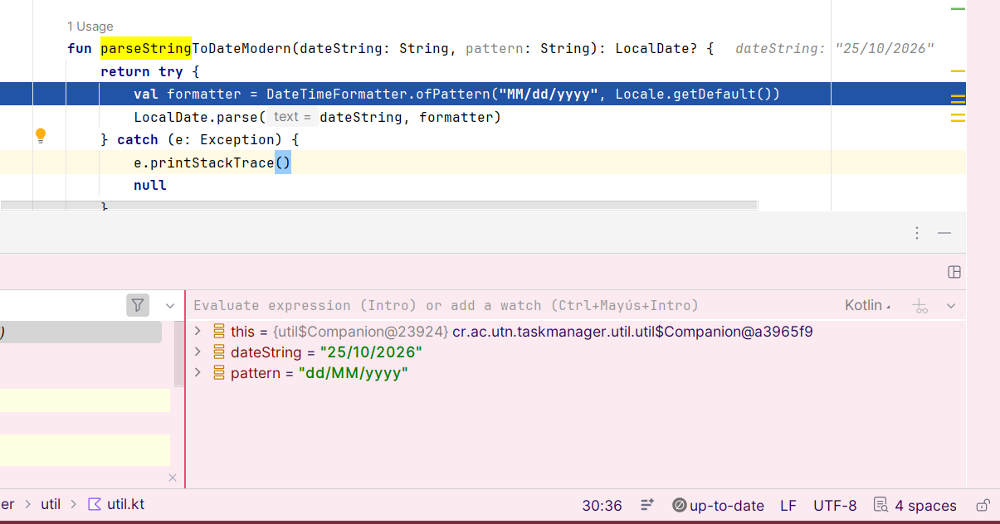

**Archivo:** `util.kt`

**Problema:** El formulario enviaba fechas en formato `dd/MM/yyyy`, pero el método `parseStringToDateModern()` intentaba leerlas como `MM/dd/yyyy`.

**Depuración:** Coloqué un breakpoint y revisé las variables `dateString` y `pattern`. Así comprobé que los formatos no coincidían.

**Solución:** Cambié la línea para que utilizara el formato recibido en `pattern`.

**Código corregido:**

```kotlin
val formatter = DateTimeFormatter.ofPattern(pattern, Locale.getDefault())
```

**Resultado:** Volví a probar el formulario y la tarea se guardó correctamente.

### Evidencia de la corrección

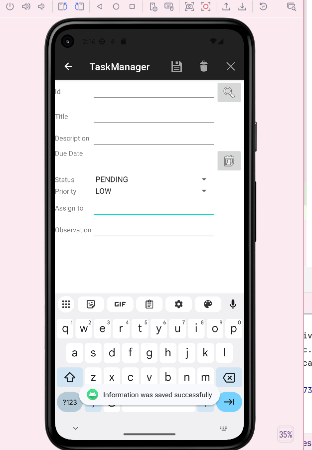

---

## Error 2. Modo de edición incorrecto

### Evidencia del error

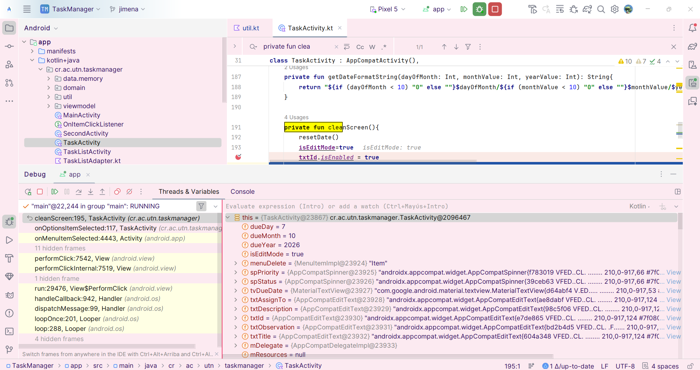

**Archivo:** `TaskActivity.kt`

**Problema:** Al limpiar el formulario, `cleanScreen()` dejaba `isEditMode` en `true` y la aplicación seguía en modo edición.

**Depuración:** Puse un breakpoint en `cleanScreen()` y comprobé que `isEditMode` seguía en `true`.

**Solución:** Cambié el valor de `isEditMode` para regresar al modo de creación.

**Antes:**

```kotlin
isEditMode = true
```

**Después:**

```kotlin
isEditMode = false
```

**Resultado:** El formulario regresó correctamente al modo de creación, permitiendo registrar nuevas tareas.

### Evidencia de la corrección

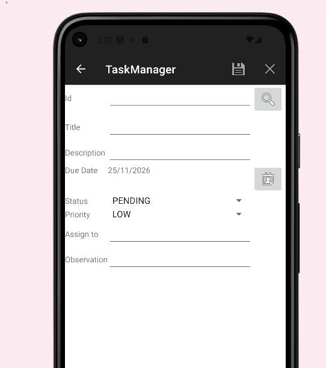

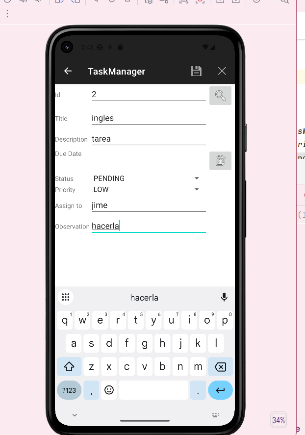

---

## Error 3. Mes incorrecto en el calendario

### Evidencia del error

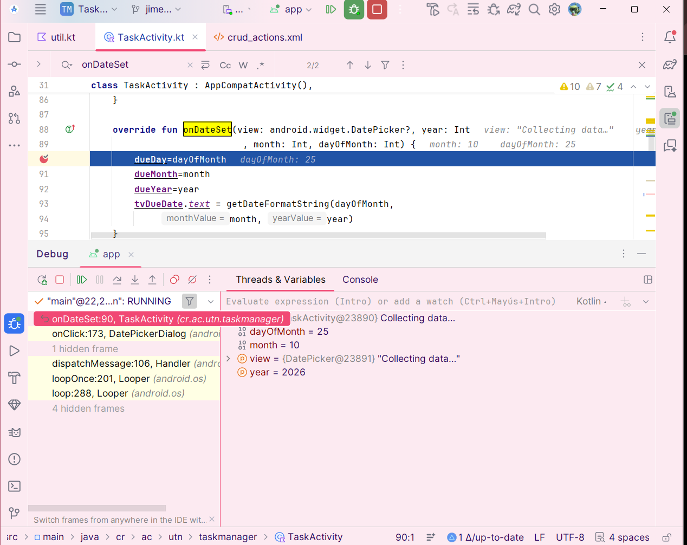

**Archivo:** `TaskActivity.kt`

**Problema:** El calendario mostraba un mes anterior al seleccionado porque `DatePicker` cuenta los meses de 0 a 11.

**Depuración:** Seleccioné el 25 de noviembre de 2026 y, con un breakpoint en `onDateSet()`, observé que `month` valía 10.

**Solución:** Sumé 1 al mes al mostrarlo y resté 1 al recuperar una fecha para el calendario.

**Resultado:** La fecha se mostró correctamente, respetando el mes seleccionado por el usuario.

---

## Error 4. Activity no registrada en el Manifest

### Evidencia del error

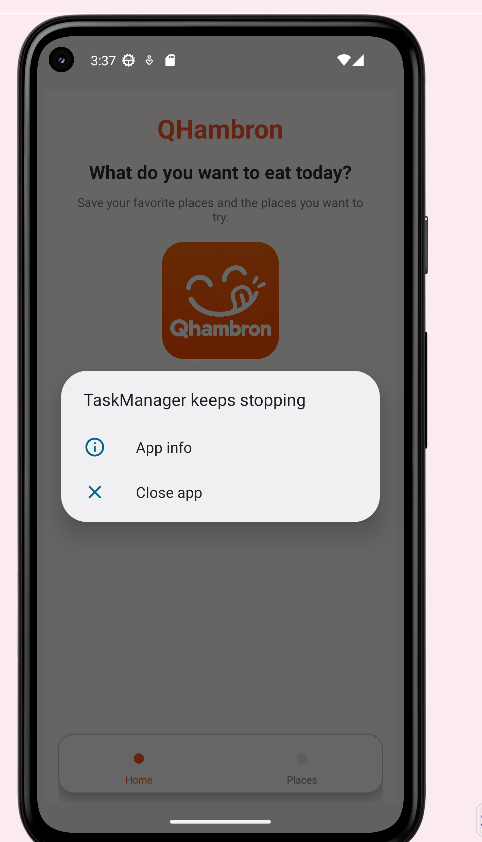

**Archivo:** `AndroidManifest.xml`

**Problema:** Al presionar el botón `TASK LIST`, la aplicación se cerraba inesperadamente.

**Revisión:** Comprobé que `TaskListActivity` no estaba declarada en el archivo `AndroidManifest.xml`.

**Solución:** Registré `TaskListActivity` dentro de la etiqueta `application` del Manifest.

**Código agregado:**

```xml
<activity android:name=".TaskListActivity" />
```

**Resultado:** La pantalla de tareas volvió a abrir correctamente, sin provocar el cierre de la aplicación.

---

## Error 5. Identificador incorrecto al abrir una tarea

### Evidencia del error

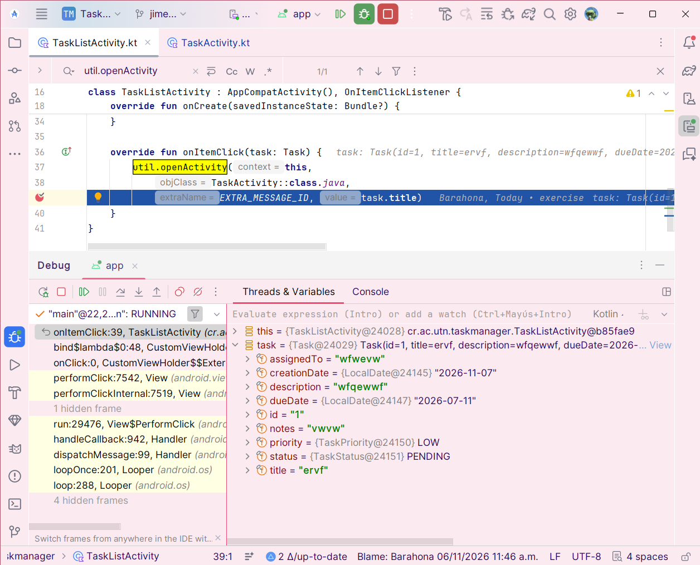

**Archivo:** `TaskListActivity.kt`

**Problema:** Al seleccionar una tarea, se enviaba su título (`task.title`) en vez de su identificador (`task.id`).

**Depuración:** Revisé `EXTRA_MESSAGE_ID` en `TaskListActivity.kt` y comprobé que se enviaba el título, aunque la pantalla buscaba la tarea por su ID.

**Solución:** Cambié el dato enviado al abrir `TaskActivity`.

**Antes:**

```kotlin
extraName = EXTRA_MESSAGE_ID, value = task.title
```

**Después:**

```kotlin
extraName = EXTRA_MESSAGE_ID, value = task.id
```

**Resultado:** Al seleccionar una tarea, la aplicación pudo identificarla correctamente utilizando su ID.

### Evidencia de la corrección

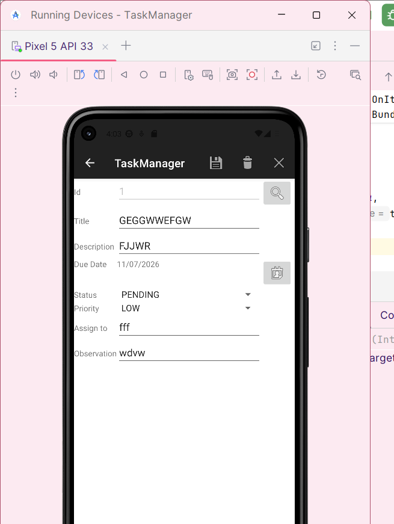

---

## Error 6. Posición incorrecta en RecyclerView

### Evidencia del error

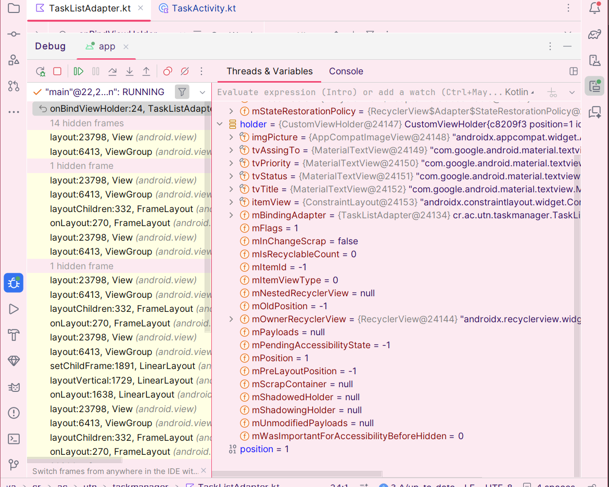

**Archivo:** `TaskListAdapter.kt`

**Problema:** El método `onBindViewHolder()` usaba la posición anterior (`position - 1`), lo que provocaba que se repitieran tareas en la lista.

**Depuración:** Coloqué un breakpoint en `onBindViewHolder()`. Cuando `position` era 1, comprobé que el código tomaba `tasks[0]` en lugar de `tasks[1]`.

**Solución:** Reemplacé la línea incorrecta para utilizar directamente la posición recibida.

**Antes:**

```kotlin
val item = if (position > 0) tasks[position - 1] else tasks[position]
```

**Después:**

```kotlin
val item = tasks[position]
```

**Resultado:** El RecyclerView mostró las tareas según su posición correspondiente, evitando que se repitieran registros.

### Evidencia de la corrección

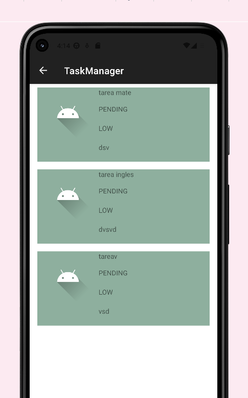
