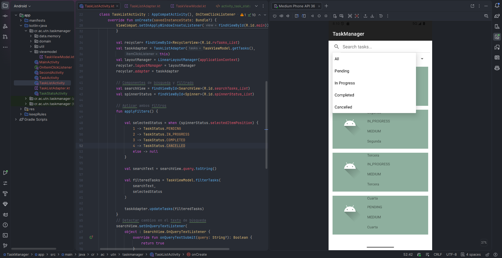
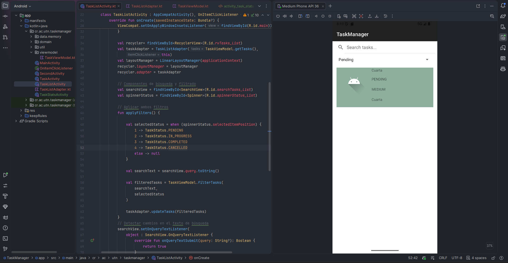
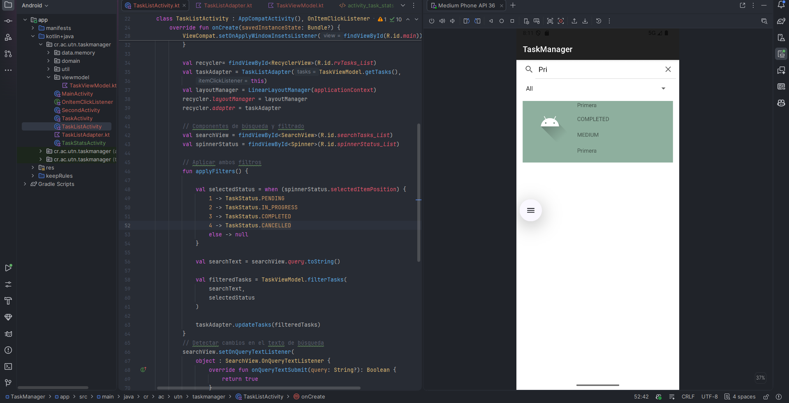

# Resolución de práctica - Charlie

**Asignatura:** Desarrollo de Aplicaciones Móviles  
**Proyecto:** TaskManager  
**Rama:** `Caguirret`  
**Repositorio:** https://github.com/utn-app-movil/exercise-g1

## Fase 0. Corrección de errores

Revisé el proyecto y corregí los ocho errores encontrados:

| Error | Problema y solución | Evidencia |
|---|---|---|
| 1 | La lista no abría: registré `TaskListActivity` en el manifiesto. | [Antes](evidencias/01_manifest_antes.png) · [Después](evidencias/01_manifest_despues.png) |
| 2 | El calendario mostraba el mes incorrecto: ajusté el número de mes. | [Corrección](evidencias/02_calendario_mes_corregido.png) |
| 3 | La fecha se leía con un formato fijo: corregí el uso de `pattern`. | [Antes](evidencias/03_formato_fecha_antes.png) · [Después](evidencias/03_formato_fecha_despues.png) |
| 4 | Una fecha vacía podía causar un error: agregué validación. | [Antes](evidencias/04_fecha_nula_antes.png) · [Después](evidencias/04_fecha_nula_despues.png) |
| 5 | Al editar, el calendario abría en otro mes: corregí el mes inicial. | [Antes](evidencias/05_mes_edicion_antes.png) · [Después](evidencias/05_mes_edicion_despues.png) |
| 6 | El formulario permanecía en modo edición: restablecí `isEditMode`. | [Antes](evidencias/06_modo_edicion_antes.png) · [Después](evidencias/06_modo_edicion_despues.png) |
| 7 | La lista repetía tareas: corregí el acceso por posición. | [Antes](evidencias/07_lista_antes.png) · [Después](evidencias/07_lista_despues.png) |
| 8 | Se enviaba el título en lugar del ID: corregí el dato al abrir la tarea. | [Antes](evidencias/08_identificador_antes.png) · [Después](evidencias/08_identificador_despues.png) |

También agregué confirmación antes de **actualizar** y **eliminar** una tarea. Ambas acciones se probaron en el emulador. [Evidencia de eliminación](evidencias/09_confirmacion_eliminar.png).

## Fase 1. Estadísticas

Creé `TaskStatsActivity` para mostrar el total de tareas, su cantidad por estado y el porcentaje completado con una barra de progreso. Los cálculos se realizan desde `TaskViewModel`.

## Fase 2. Búsqueda y filtros

Agregué una búsqueda por texto y un filtro por estado (`TODAS`, `PENDING`, `IN_PROGRESS`, `COMPLETED`, `CANCELLED`). Los dos filtros pueden utilizarse al mismo tiempo y actualizan la lista en tiempo real.

**Estados disponibles:**

**Filtro por estado:**

**Búsqueda por texto:**

## Fase 3. Eliminar deslizando y deshacer

Implementé el deslizamiento de tareas hacia la izquierda o derecha para eliminarlas. Después aparece un mensaje con la opción **DESHACER** para restaurar la tarea. Probado en el emulador, incluso con filtros activos.

**Evidencia pendiente:** captura con el mensaje **DESHACER** visible.

---

**Resultado:** la aplicación compila y las funcionalidades solicitadas se probaron en el emulador Android. Falta adjuntar la captura de confirmación al actualizar y la del mensaje **DESHACER** para completar las evidencias.
