# Resolución de práctica - Charlie

**Asignatura:** Desarrollo de Aplicaciones Móviles  
**Proyecto:** TaskManager  
**Rama:** `Caguirret`  
**Repositorio:** https://github.com/utn-app-movil/exercise-g1

## Fase 0: Corrección de errores

En esta fase revisé los errores del proyecto y realicé los siguientes cambios.

### Error 1. No abría la lista de tareas

**Archivo:** `AndroidManifest.xml`

La aplicación fallaba al entrar a Task List porque faltaba registrar `TaskListActivity`. Agregué la actividad al manifiesto.

**Antes:**

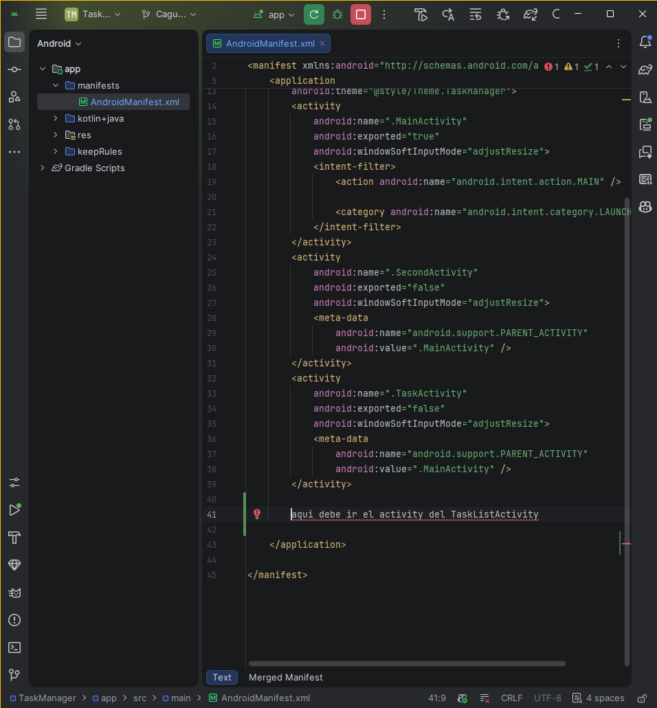

**Después:**

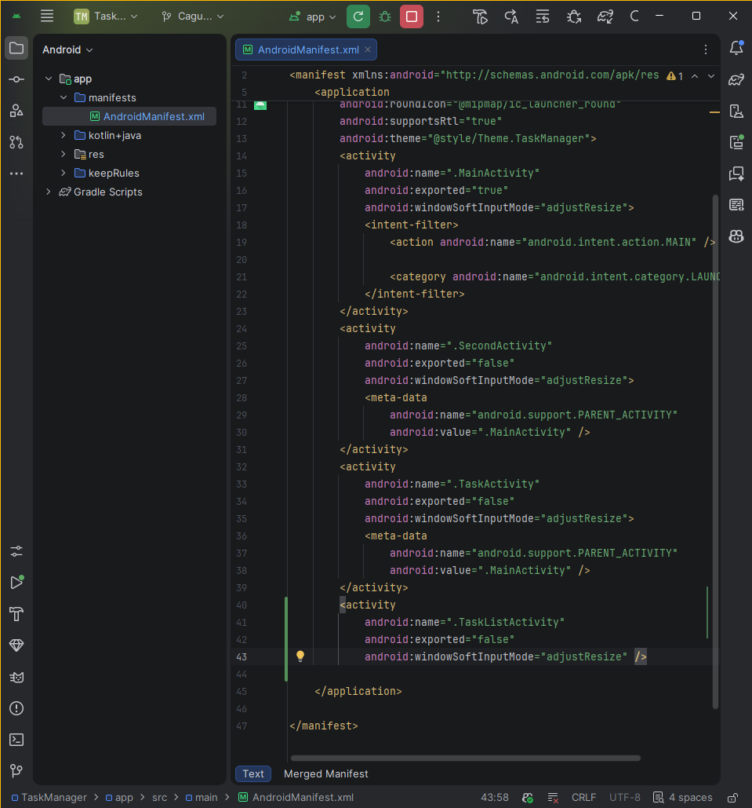

### Error 2. El calendario mostraba mal el mes

**Archivo:** `TaskActivity.kt`

El calendario contaba los meses desde cero. Sumé `1` al mes cuando se muestra la fecha, para que aparezca el mes correcto.

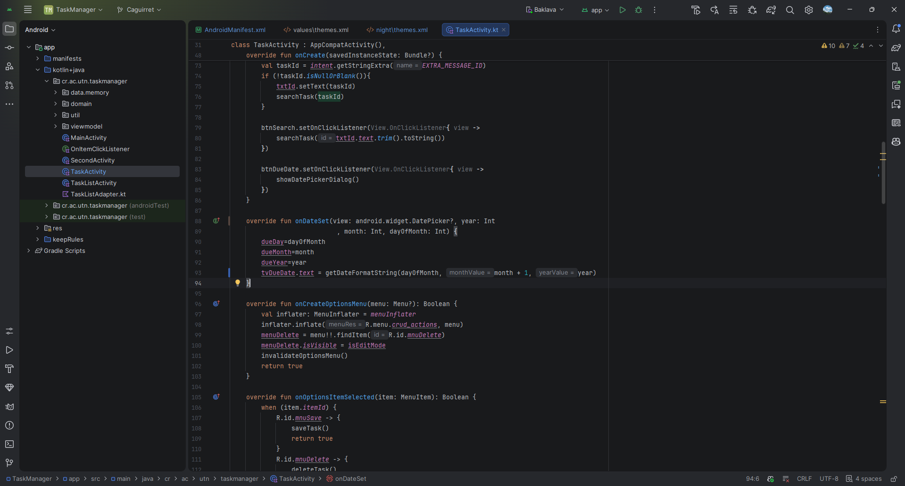

### Error 3. Formato incorrecto de la fecha

**Archivo:** `util.kt`

La función usaba un formato fijo para leer las fechas. Lo cambié para que utilice el formato recibido en `pattern`.

**Antes:**

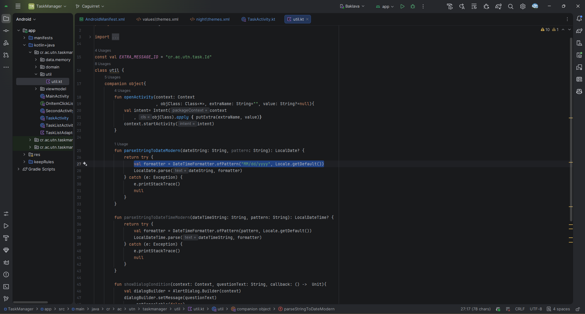

**Después:**

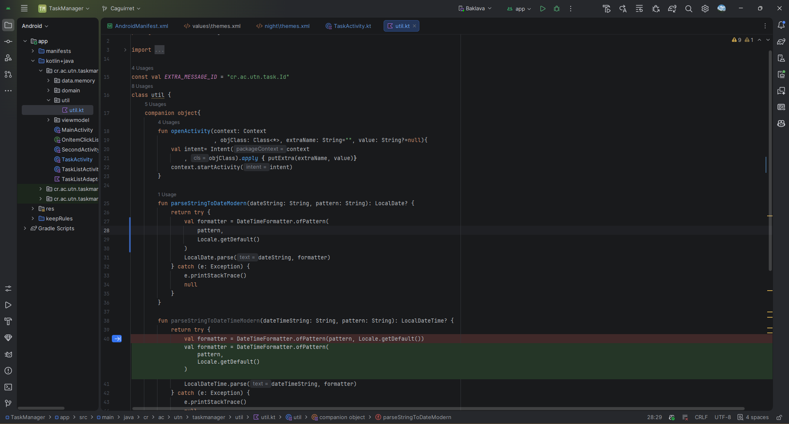

### Error 4. La aplicación podía fallar con una fecha inválida

**Archivo:** `TaskActivity.kt`

Se usaba `!!` aunque la fecha podía ser `null`. Agregué una validación y ahora se utiliza directamente `dueDate` cuando la fecha es válida.

**Antes:**

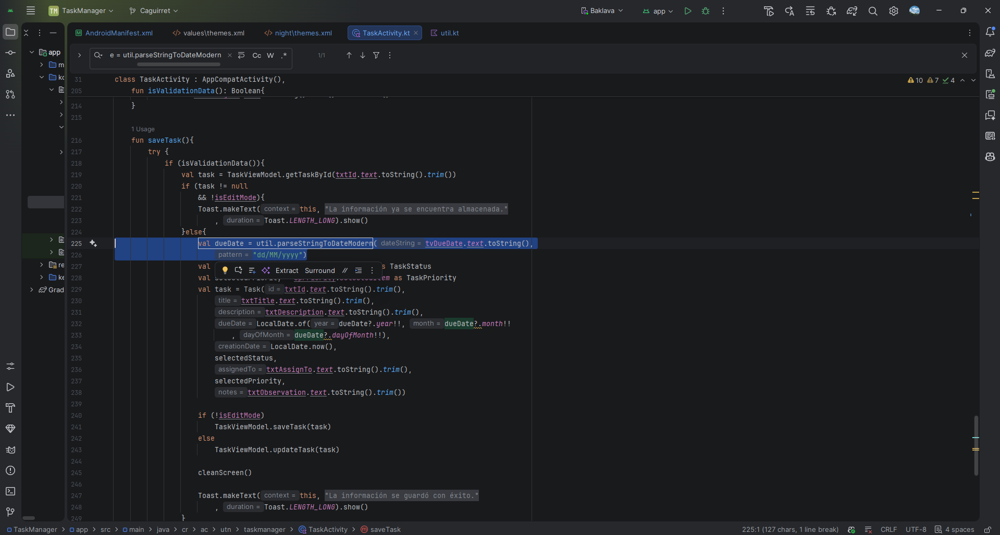

**Validación:**

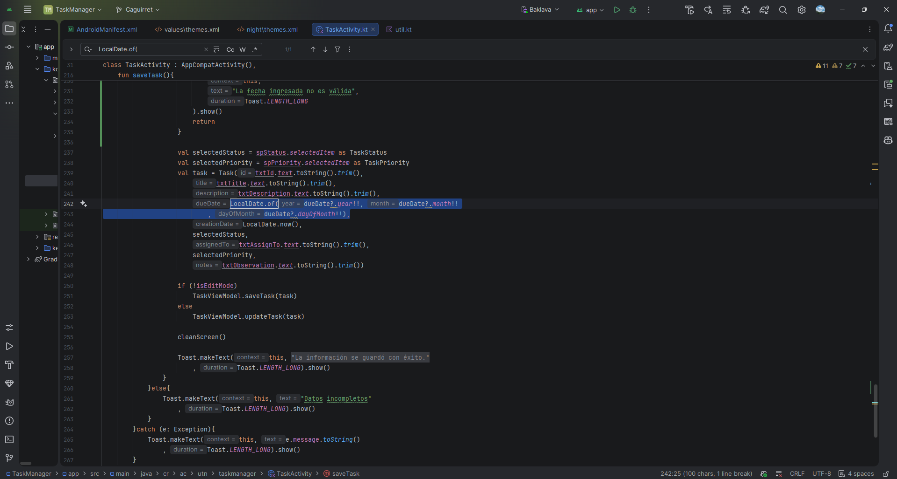

**Después:**

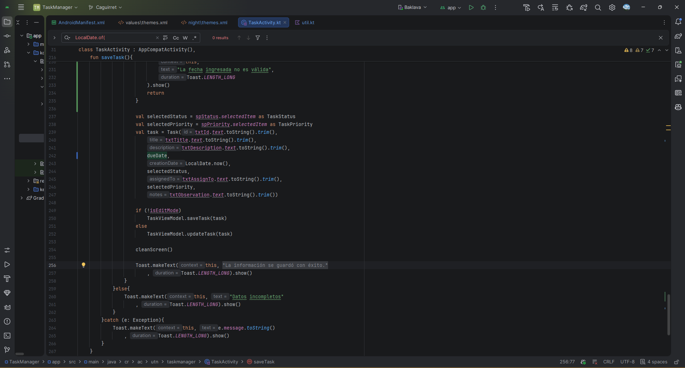

### Error 5. Al editar, el calendario abría en otro mes

**Archivo:** `TaskActivity.kt`

Al cargar una tarea, el mes quedaba adelantado. Resté `1` a `monthValue` para abrir el calendario en el mes correcto.

**Antes:**

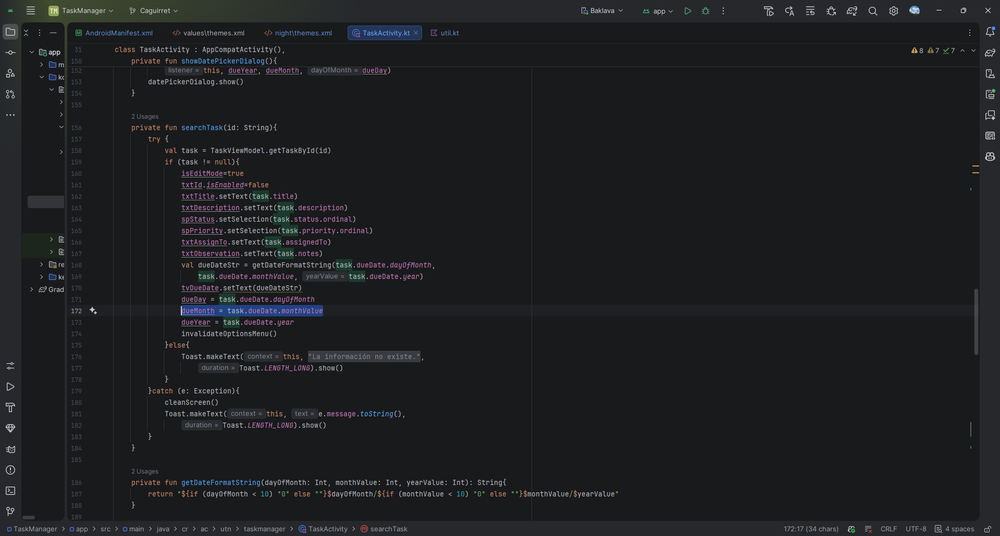

**Después:**

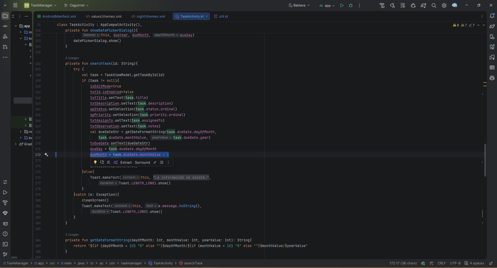

### Error 6. El formulario quedaba en modo edición

**Archivo:** `TaskActivity.kt`

Después de limpiar el formulario, seguía activado el modo edición. Cambié `isEditMode` a `false` para poder registrar tareas nuevas.

**Antes:**

**Después:**

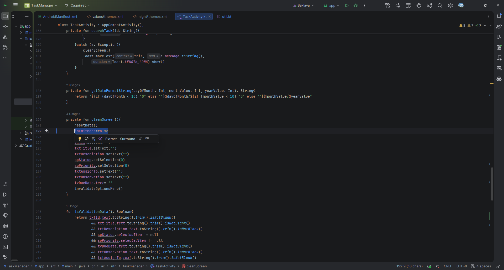

### Error 7. La lista repetía tareas

**Archivo:** `TaskListAdapter.kt`

Se restaba `1` a la posición de algunas tareas y se repetían en pantalla. Cambié el acceso a `tasks[position]`.

**Antes:**

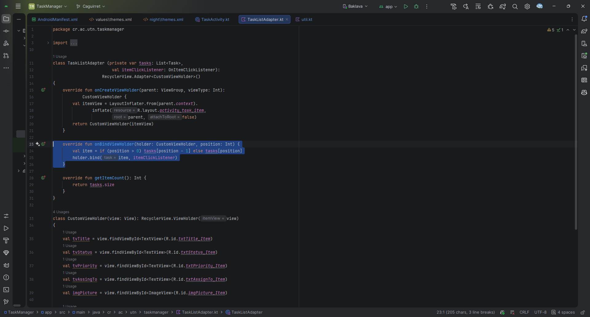

**Después:**

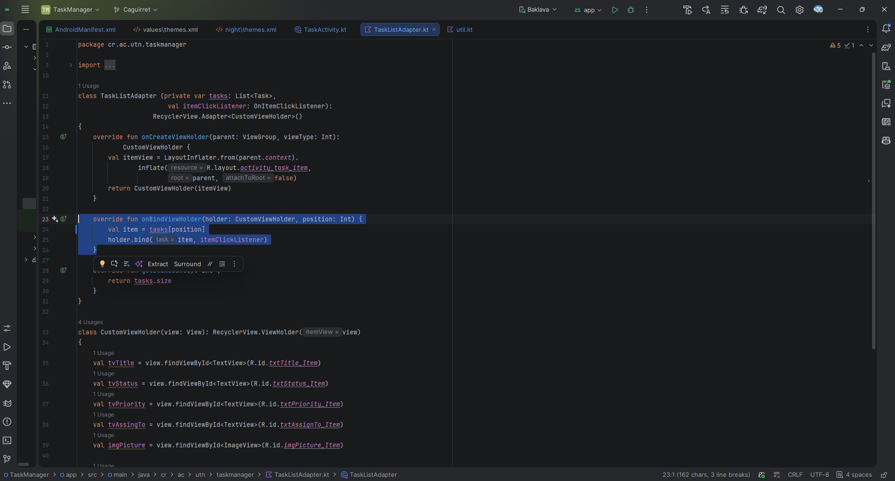

### Error 8. Se enviaba el título en vez del ID

**Archivo:** `TaskListActivity.kt`

Al seleccionar una tarea se enviaba el título, pero la búsqueda utilizaba el ID. Cambié `task.title` por `task.id`.

**Antes:**

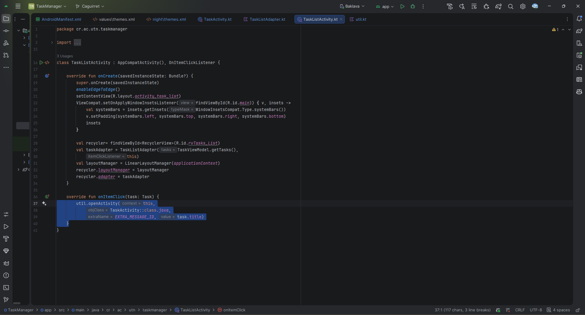

**Después:**

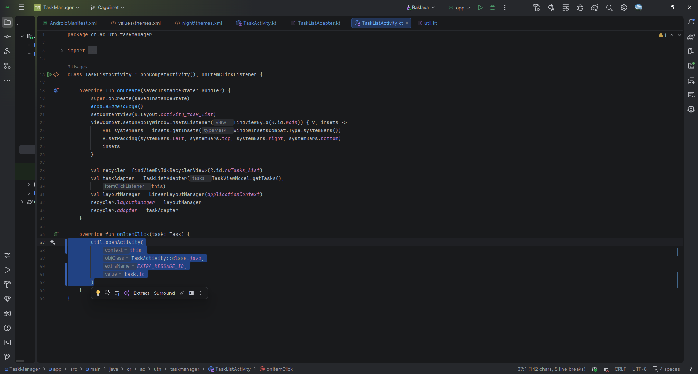

### Confirmación al eliminar y actualizar

Agregué una pregunta de confirmación antes de eliminar una tarea, para evitar borrarla por accidente. También se agregó una confirmación para actualizar una tarea existente.

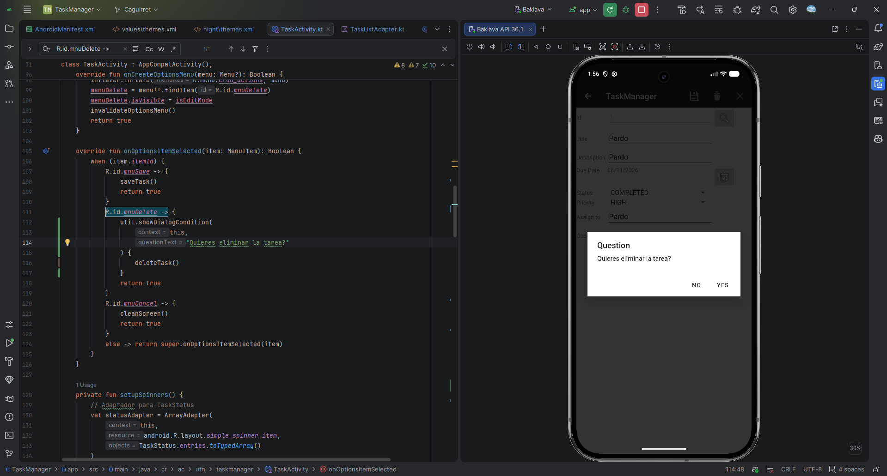

> **Evidencia pendiente:** agregar aquí una captura del diálogo de confirmación al **actualizar** una tarea.

---

## Fase 1: Estadísticas

**Pendiente de desarrollar.** Agregaré las capturas y una explicación corta cuando termine `TaskStatsActivity`.

## Fase 2: Búsqueda y filtros

**Pendiente de desarrollar.** Agregaré la búsqueda por texto y el filtro por estado.

## Fase 3: Eliminar deslizando y deshacer

**Pendiente de desarrollar.** Agregaré las evidencias de Swipe to Delete y DESHACER.
