# TRABAJO EVALUATIVO

## Solución de la Fase 0
### Guía de Errores Intencionales de Código (Debugging - 45 min)

#### 1. Error de validación de fecha pasada
Encontré un error de validación ya que se puede elegir una fecha pasada:

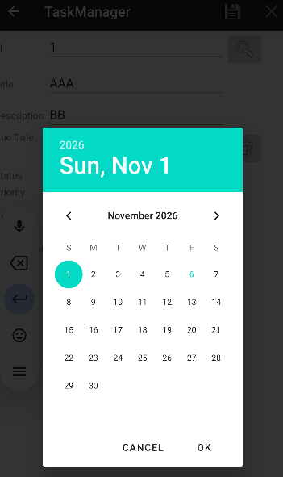

Para solucionar eso me dirigí a `TaskActivity.kt` y corregí:

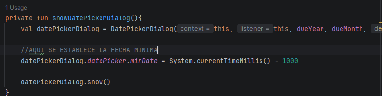

Ya no permite seleccionar fechas anteriores:

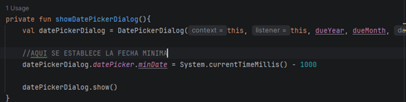

#### 2. Error al hacer clic en Task List
Otro error sería que al darle clic a **Task List** me saca de la aplicación:

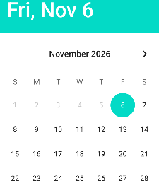

**Solucionado:**
Para esto nos vamos a `AndroidManifest.xml`, y agregamos la actividad:

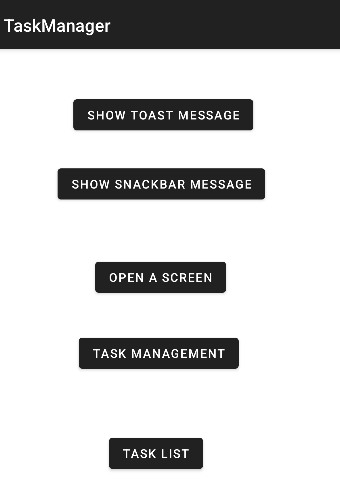

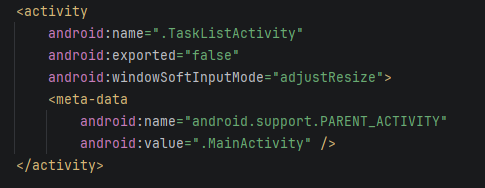

Task list ya con datos de prueba:

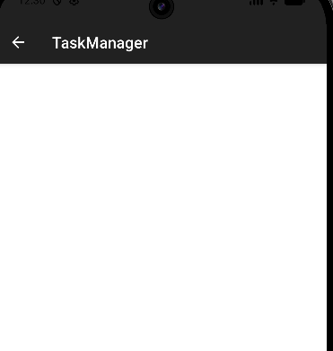

#### 3. Error al recrear una tarea con el mismo ID
Cuando creo una tarea con ID 1 (por ejemplo), la guarda y después la borro, e intento crear una nueva con ese mismo ID, me sale un mensaje de `NULL`:

Para eso vamos a `TaskActivity.kt` y realizamos esto:

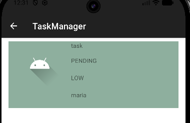

#### 4. Error al duplicar la primera tarea en la lista
Al agregar una serie de tareas, en la lista de tareas se repite la primera tarea que se agregó, o sea se repite la misma tarea en la lista:

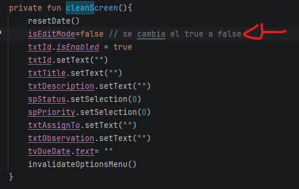

Para solucionar vamos a `TaskListAdapter.kt`, revisamos este código:

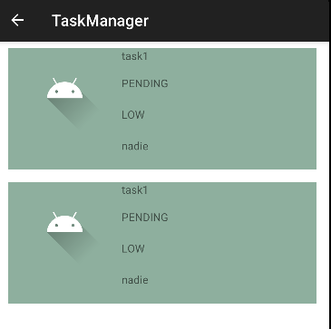

Y para solucionarlo lo corregimos por:

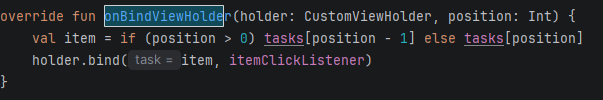

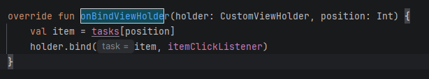

Solucionado.

#### 5. Error al rellenar los campos al seleccionar una tarea
En **Task List** logro ver dos tareas distintas. Al darle clic a una de estas para realizar una función específica se supone que debería de rellenar los campos con los valores y la data correspondiente de esta tarea, pero no es así. En las fotos logramos observar mejor el error:

Información de `t2`:

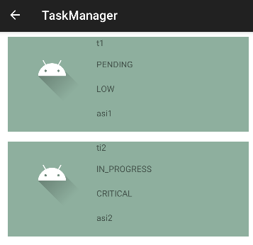

Información en `TaskList`:

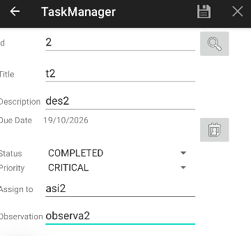

Al darle clic a `t2` me sale así (vacío o con datos incorrectos):

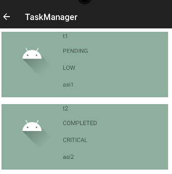

Para solucionarlo vamos a realizar lo siguiente:  
Corregir el lugar donde se configura el evento de clic en tu adaptador de la lista, `TaskListActivity.kt`.  
El código tiene este bloque:

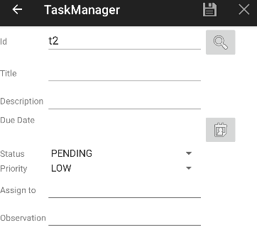

Hay que modificarlo y cambiarlo por:

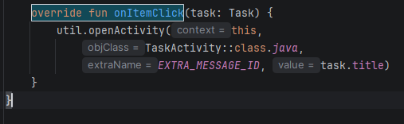

AHORA SÍ, al darle clic en `TaskList` sí me completa los campos con la información de esa tarea:

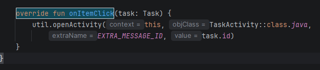