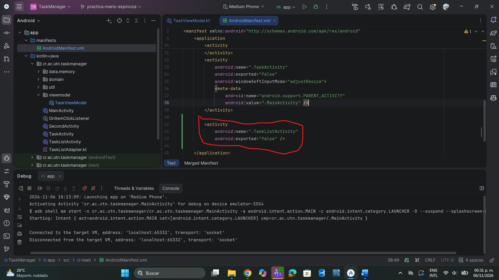
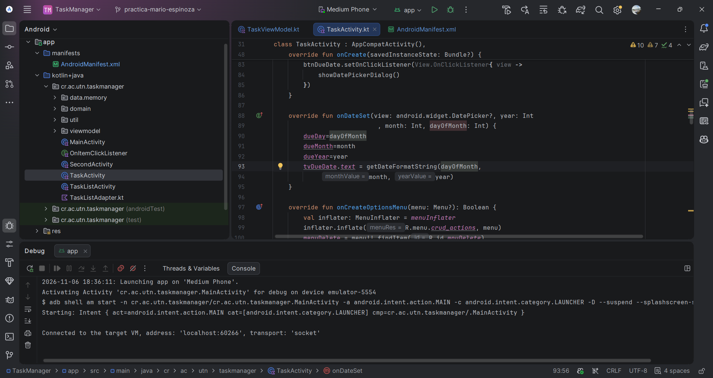
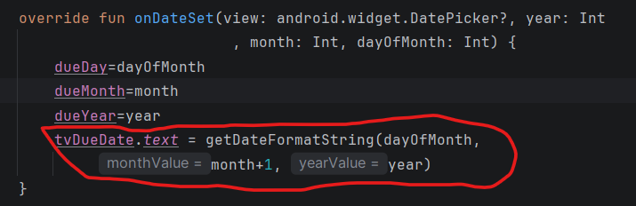
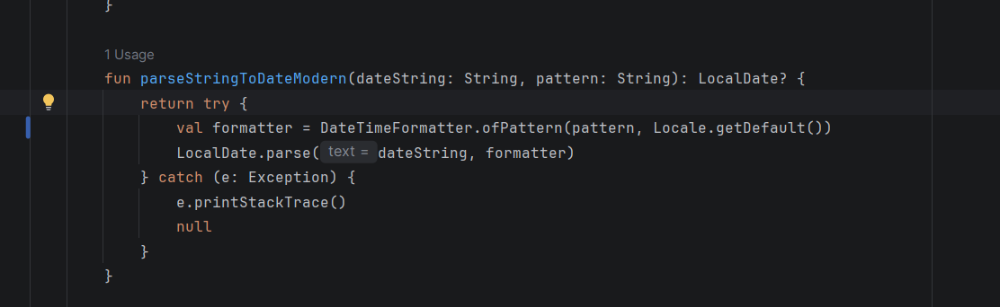
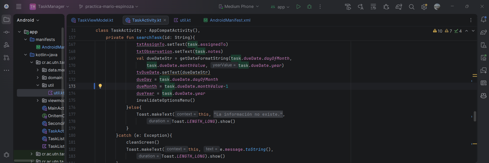
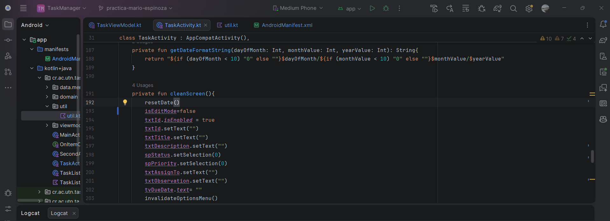
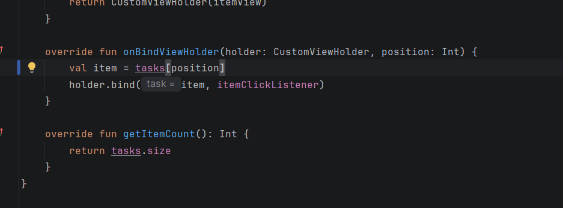
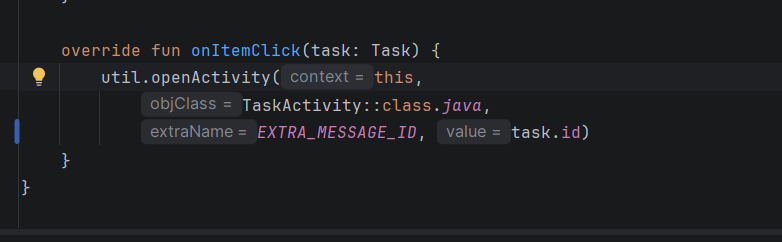

# Resolución de la práctica TaskManager

**Mario Espinoza · Avance de depuración**

## 1. La lista de tareas cerraba la aplicación

Al tocar el botón de la lista, Android no encontraba `TaskListActivity`. Agregué la actividad dentro de `<application>` en `AndroidManifest.xml`.

## 2. Enero se mostraba como mes 00

El selector de fechas devuelve enero como `0`. En `TaskActivity.onDateSet()` sumé 1 al mes al mostrar la fecha. Para abrir el selector conservé el valor original.

## 3. La lectura de la fecha usaba el formato incorrecto

En `util.kt`, el formateador usaba `MM/dd/yyyy` de forma fija. Lo cambié para que use el parámetro `pattern`. El formulario pasa `dd/MM/yyyy`.

## 4. El selector abría en el mes equivocado al editar

Al cargar una tarea, `LocalDate.monthValue` devuelve enero como `1`. En `searchTask()` resté 1 al guardarlo en `dueMonth`, que es el valor que recibe el selector.

## 5. El formulario limpio quedaba en modo edición

En `cleanScreen()` cambié `isEditMode` a `false`. Así, el siguiente guardado pasa por la validación de ID duplicado para tareas nuevas.

## 6. La lista repetía una tarea y omitía la última

En `TaskListAdapter.kt`, el adaptador restaba 1 a la posición desde la segunda fila. Cambié la selección a `tasks[position]` para que cada fila muestre la tarea que le corresponde.

## 7. Al tocar una tarea, el formulario no encontraba sus datos

En `TaskListActivity.kt` cambié el dato enviado al formulario de `task.title` a `task.id`, porque el formulario busca la tarea por ID.

## Pendiente en este avance

- Ajustar el guardado para usar el `LocalDate` leído directamente. El código actual vuelve a sumar 1 al mes al guardar y todavía usa `!!` si falla la lectura de la fecha.
- Agregar los diálogos de confirmación para actualizar y eliminar.
