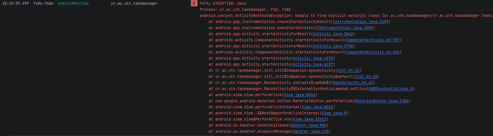
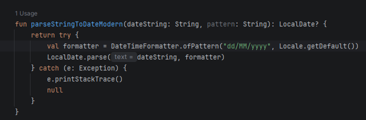
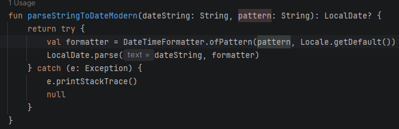
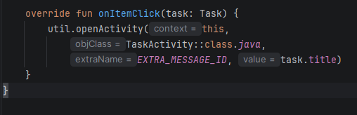
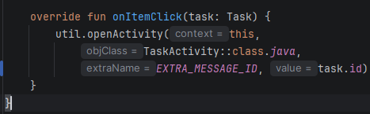
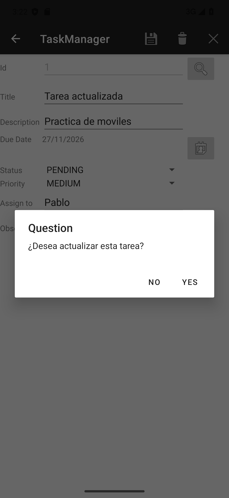
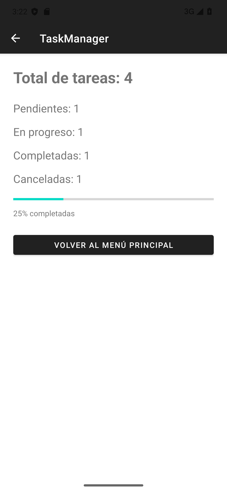
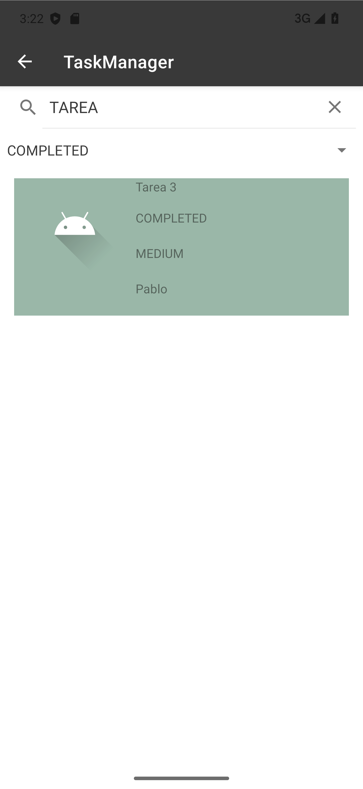
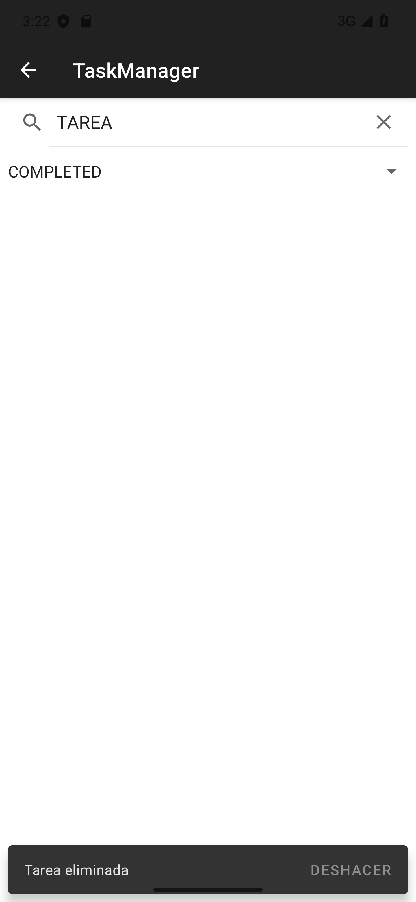

# Resolución de práctica - TaskManager

**Estudiante:** Pablo Aguerp

**Curso:** Desarrollo de Aplicaciones Móviles

**Rama:** Pablo

**Fecha de actualización:** 12 de noviembre de 2026

## Fase 0: errores y correcciones

| Problema | Corrección |
| --- | --- |
| La lista no abría y mostraba `ActivityNotFoundException`. | Se registró `TaskListActivity` en `AndroidManifest.xml`. |
| El adaptador repetía la tarea anterior con `position - 1`. | Se usa `tasks[position]`. |
| Las fechas se interpretaban como `MM/dd/yyyy`. | `parseStringToDateModern` usa el parámetro `pattern`, que recibe `dd/MM/yyyy` desde el formulario. |
| El selector mostraba un mes menos. | Al mostrar la fecha se usa `month + 1`, porque el selector empieza los meses en cero. |
| Al editar, el calendario abría un mes después. | Se carga `dueMonth = task.dueDate.monthValue - 1`. |
| Al tocar una tarea se enviaba el título en lugar del identificador. | Se envía `task.id` en el `Intent`. |
| Después de limpiar el formulario seguía activo el modo edición. | `cleanScreen()` deja `isEditMode = false` y habilita el identificador. |
| En el tema nocturno no aparecía la barra con las acciones. | Se usa `Theme.MaterialComponents.DayNight.DarkActionBar`, igual que en el tema normal. |

También se quitó `invalidateOptionsMenu()` de `onCreateOptionsMenu()`. La visibilidad de eliminar se actualiza en `onPrepareOptionsMenu()` según el modo edición.

### Evidencias anteriores de depuración

Estas capturas ya estaban en la rama y corresponden a la revisión inicial.

Formato de fecha antes y después:

Identificador enviado al abrir la tarea:

Las imágenes `02_selector_fecha_revisar.png` y `07_clean_screen_pendiente.png` muestran intentos anteriores incorrectos. No representan el código final: no se suma uno al día y el modo edición queda en `false` al limpiar.

### Confirmaciones

Se utiliza `util.showDialogCondition()` antes de actualizar y eliminar. Si se responde No, no se modifica la tarea. Al crear una tarea nueva se guarda directamente.

## Fase 1: estadísticas

Se agregó `TaskStatsActivity` con su XML y un botón en el menú principal. Muestra el total, la cantidad por cada estado y una barra horizontal con el porcentaje completado. Los cálculos están en `TaskViewModel` y utilizan `count`. Cuando no hay tareas, el porcentaje es cero para evitar dividir entre cero. El botón Volver cierra la pantalla y regresa al menú.

## Fase 2: búsqueda y filtros

La lista tiene un `SearchView` y un `Spinner` con TODAS y los cuatro estados. `filterTasks()` en el ViewModel combina el texto del título o descripción con el estado seleccionado. La búsqueda ignora mayúsculas y minúsculas. La lista también se actualiza en `onResume()` al regresar del formulario.

## Fase 3: deslizar para eliminar

Se agregó `ItemTouchHelper.SimpleCallback`. Al deslizar una fila se elimina la tarea que está visible en esa posición y aparece un `Snackbar` con DESHACER. Al pulsarlo se guarda de nuevo la misma tarea y se aplican los filtros actuales.

## Comprobaciones

- Compilación `assembleDebug` y pruebas `testDebugUnitTest`: correctas.
- Pruebas instrumentadas en Pixel 7 Pro con Android 13: estadísticas vacías, cuatro tareas con 25% completado, navegación desde el menú, búsqueda por descripción sin distinguir mayúsculas, combinación sin resultados, filtro por estado y eliminar/deshacer con filtro activo.
- Se comprobó la carga por identificador, la fecha 27/11/2026, cancelar y aceptar una actualización, limpiar el formulario y cancelar y aceptar una eliminación.

Las capturas 10 a 13 se obtuvieron durante las pruebas instrumentadas con datos de ejemplo. Son evidencia funcional; no son capturas de breakpoints de Android Studio. No se volvió a comprobar manualmente el tema nocturno ni todos los casos de la depuración inicial.

Se conservó la estructura del proyecto de clase: Activities, XML, ViewModel y repositorio en memoria. No se agregaron dependencias. Las tareas se pierden al finalizar el proceso de la aplicación, igual que en el proyecto base.

## Entrega

PR de la rama Pablo hacia main: https://github.com/utn-app-movil/exercise-g1/pull/10
