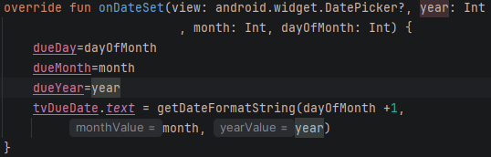
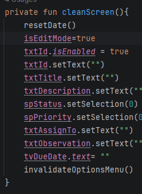
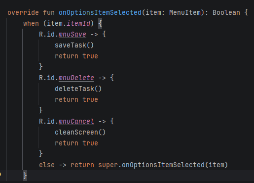
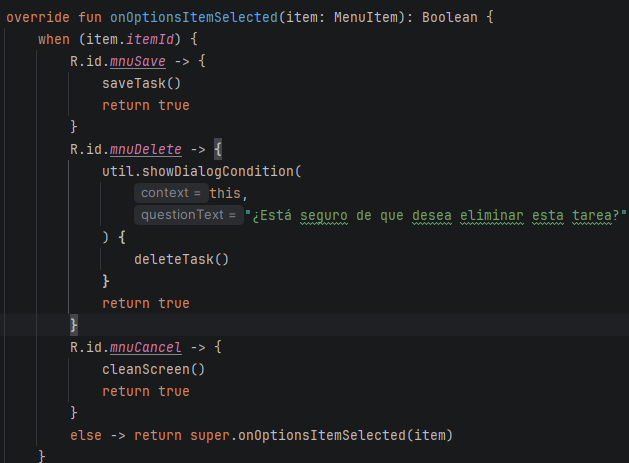

# Resolución de práctica — TaskManager (avance parcial)

**Estudiante:** Pablo Aguerp 
**Curso:** Desarrollo de Aplicaciones Móviles  
**Repositorio base:** https://github.com/utn-app-movil/exercise-g1  
**Fecha:** 6 de noviembre de 2026  
**Estado:** Fase 0 en desarrollo. Los cambios documentados aquí son evidencias de revisión/código, no una certificación de que todas las pruebas pasaron.

## Objetivo

Durante esta práctica revisé errores del proyecto TaskManager en Kotlin. Utilicé Android Studio para identificar fallos en el inicio de pantallas, selección de fechas, búsqueda de tareas y operaciones de edición y eliminación. Adjunto capturas de Logcat y comparaciones de código. Las pruebas funcionales pendientes se registran expresamente.

## 1. Error al abrir la lista de tareas

**Archivo:** `TaskManager/app/src/main/AndroidManifest.xml`  
**Diagnóstico:** al intentar abrir `TaskListActivity`, Logcat presentó `ActivityNotFoundException`. La actividad no estaba registrada en el manifiesto.  
**Solución aplicada o por verificar:** declarar `<activity android:name=".TaskListActivity" android:exported="false" />` dentro de `<application>`.  
**Prueba pendiente:** mostrar captura de la lista abriéndose sin cierre inesperado.

## 2. Desplazamiento incorrecto en la lista

**Archivo:** `TaskListAdapter.kt`, método `onBindViewHolder()`.  
**Causa identificada en el código base:** la expresión `tasks[position - 1]` para posiciones mayores de cero repetía elementos.  
**Solución propuesta:** utilizar `tasks[position]`.  
**Evidencia pendiente:** capturas antes/después del adaptador y prueba de la lista con varias tareas.

## 3. Errores al interpretar fechas

**Archivos:** `util.kt` y `TaskActivity.kt`.  
**Error observado en Logcat durante la práctica:** `DateTimeParseException` al interpretar `27/11/2026` como si el número 27 correspondiera al mes.  
**Causa:** la función utilizaba `MM/dd/yyyy` mientras el formulario enviaba fechas `dd/MM/yyyy`.  
**Corrección mostrada:** usar el argumento `pattern` en `DateTimeFormatter.ofPattern(pattern, Locale.getDefault())` en lugar de un formato fijo.

**Antes:**

**Después:**

**Atención — selector de fechas:** la captura siguiente **no representa una corrección válida**: muestra `dayOfMonth + 1` en vez de `month + 1`. El día no debe incrementarse. Se debe conservar `dueDay = dayOfMonth`, `dueMonth = month` y mostrar la fecha mediante `getDateFormatString(dayOfMonth, month + 1, year)`. Al precargar el calendario desde una fecha guardada debe usarse `task.dueDate.monthValue - 1` para `dueMonth`.

**Pruebas pendientes:** guardar y volver a abrir una tarea con fecha 27/11/2026, y comprobar el mes al editarla.

## 4. Búsqueda incorrecta al seleccionar una tarea

**Archivo:** `TaskListActivity.kt`, método `onItemClick()`.  
**Causa:** se enviaba `task.title` mediante `EXTRA_MESSAGE_ID`, pero el formulario buscaba por `task.id`.  
**Corrección mostrada:** enviar `task.id`.

**Antes:**

**Después:**

**Prueba pendiente:** seleccionar una tarea y confirmar que se recupera el registro correcto.

## 5. El formulario permanece en modo edición

**Archivo:** `TaskActivity.kt`, método `cleanScreen()`.  
**Causa:** se usa `isEditMode = true` después de limpiar campos. Eso conserva el modo edición y puede afectar el guardado de nuevas tareas.  
**Corrección requerida:** reemplazar por `isEditMode = false` y conservar la actualización de menú con `invalidateOptionsMenu()`.

**Importante:** la imagen recibida todavía muestra `isEditMode = true`; por tanto es evidencia del problema, **no del arreglo**.

**Pendiente:** agregar captura del código corregido y prueba de creación de dos tareas consecutivas.

## 6. Confirmación antes de actualizar o eliminar

**Archivo:** `TaskActivity.kt`, método `onOptionsItemSelected()`.  
**Requisito del README principal:** mostrar un diálogo de verificación antes de **actualizar y eliminar**.  
**Estado de la evidencia:** la captura del código posterior muestra `util.showDialogCondition(...)` para **eliminar**. Sin embargo, en esa misma captura `mnuSave` continúa llamando directamente a `saveTask()`, por lo que **no se demuestra una confirmación para actualizar**.

**Antes:**

**Avance aportado (solo eliminar):**

**Pendiente:** condicionar `mnuSave` cuando `isEditMode` sea `true`, mostrar diálogo de confirmación para actualizar y guardar capturas de ambos diálogos en ejecución, comprobando que seleccionar «No» no cambia los datos.

Continuar comprobando errores de la Fase 0 y adjuntar capturas del depurador cuando corresponda. Después, desarrollar `TaskStatsActivity` (Fase 1), búsqueda y filtro de tareas (Fase 2), y eliminación por gesto con opción «Deshacer» (Fase 3). Conservar el trabajo en una rama personal y abrir un Pull Request hacia `main` solicitando la revisión de `ebarahonautn`.

**Nota:** La numeración usada en el documento de evidencias original no es consistente entre sus encabezados y tablas. Aquí se reorganiza por tema para evitar confusiones.
