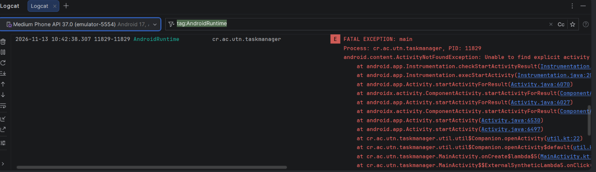
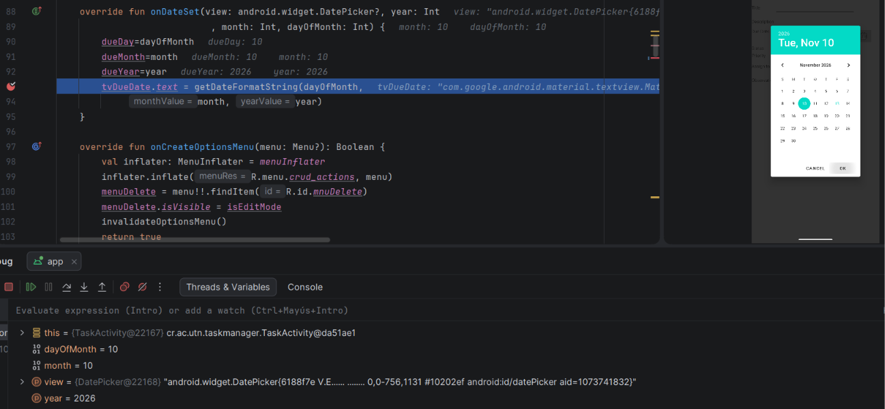
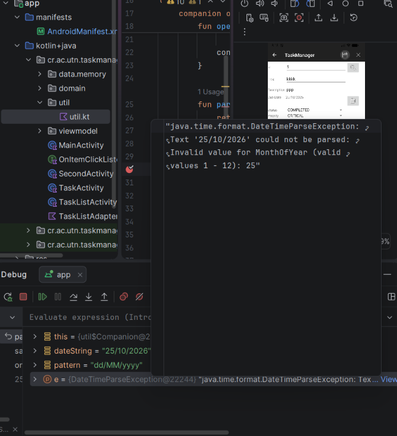
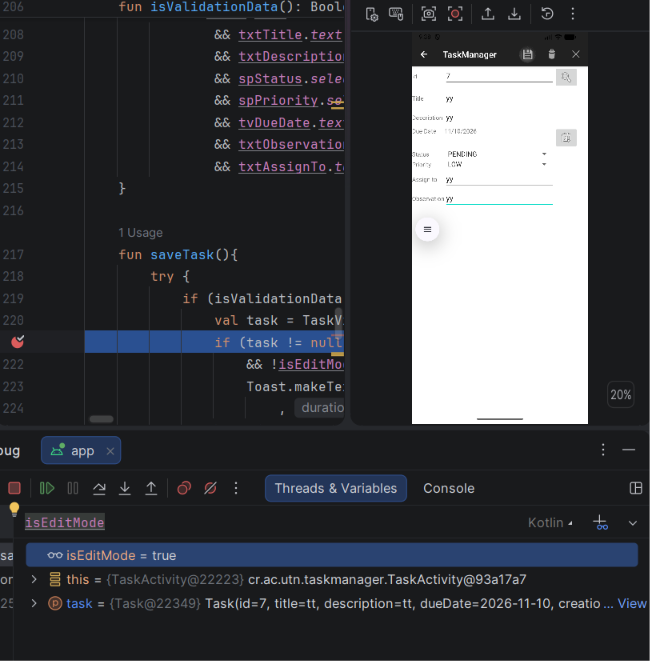

# Resolución Práctica - Saray Castillo

## Fase 0 - Errores

### Error 1
La app se cerraba al tocar "Listar tareas". En Logcat salía que no encontraba TaskListActivity. Faltaba agregarla en el AndroidManifest.xml, la agregué y ya abre.

### Error 2
Elegí el 24 de noviembre en el calendario y la fecha salía 24/10. Con el debug vi que month valía 10, porque el calendario cuenta los meses desde 0. Le sumé 1 al mostrar la fecha.

### Error 3
Al guardar una tarea con día mayor a 12 salía "null". En el debug el error decía "Invalid value for MonthOfYear: 25". En util.kt la fecha se leía como mes/día porque no usaba el pattern que recibía la función. Lo cambié para que use pattern.

### Error 4
Guardé una tarea nueva con un id que ya existía y en vez de decir que estaba duplicada la sobreescribía. Con el debug vi que isEditMode estaba en true aunque no estaba editando. En cleanScreen se ponía isEditMode=true, lo cambié a false.

