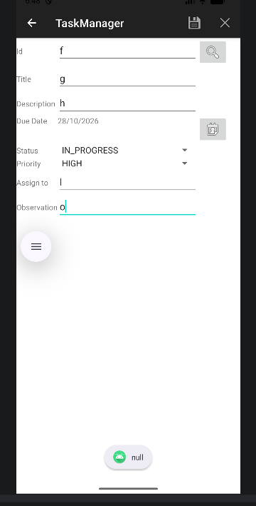
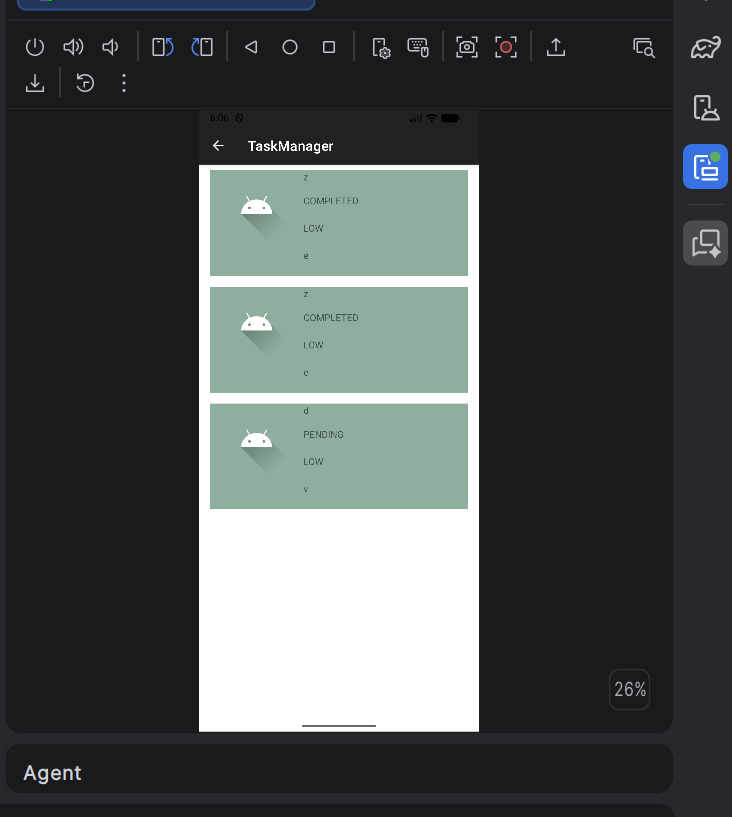
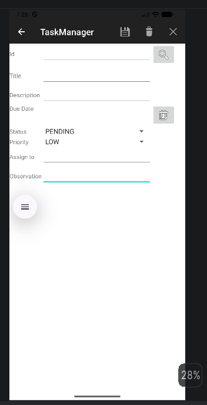

# Resolucion de errores - TaskManager

## 1. Cierre al abrir `TaskListActivity`

Al tocar el boton de la lista, la aplicacion se cerraba porque `TaskListActivity` no estaba registrada en `AndroidManifest.xml`. Se agrego la actividad al manifest y se conecto el boton correspondiente desde `MainActivity`.


## 2. Elemento incorrecto en `TaskListAdapter`

`onBindViewHolder` se ejecuta para cada fila del `RecyclerView`. Debe usar la posicion recibida para obtener el elemento que mostrara esa fila. Se corrigio el acceso a la lista para usar el indice directamente:

```kotlin
val item = tasks[position]
```

## 3. Error al interpretar fechas

El conversor de fechas ignoraba el parametro `pattern` y utilizaba un formato fijo (`MM/dd/yyyy`). Esto podia hacer que fechas con dias mayores a 12 no se interpretaran correctamente. Se cambio el formateador para usar el patron recibido:

```kotlin
DateTimeFormatter.ofPattern(pattern, Locale.getDefault())
```

## 4. Estado incorrecto al cancelar o limpiar una tarea

Al limpiar el formulario para crear una tarea nueva, se restablece `isEditMode` a `false`, se habilita el campo del ID y se actualiza el menu. Asi no queda visible la opcion de eliminar para una tarea que aun no existe.

## 5. Invalidacion repetida del menu

`invalidateOptionsMenu()` dentro de `onCreateOptionsMenu` solicitaba volver a crear el menu mientras este se estaba creando. Se retiro esa llamada de `onCreateOptionsMenu`. Se conserva la invalidacion en los puntos donde cambia el modo del formulario y hace falta refrescar la barra.

## 6. Confirmacion antes de actualizar o eliminar

Se agrego `util.showDialogCondition` en `TaskActivity` para pedir confirmacion antes de actualizar o eliminar una tarea.



## 7. Pantalla de estadisticas

Se agrego `TaskStatsActivity` y su layout `activity_task_stats.xml`, se registro la actividad en `AndroidManifest.xml` y se conecto el boton de acceso desde `MainActivity`. La pantalla muestra el total de tareas, sus cantidades por estado y el porcentaje completado.




