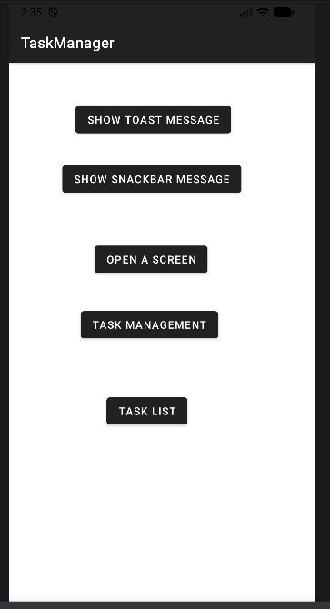
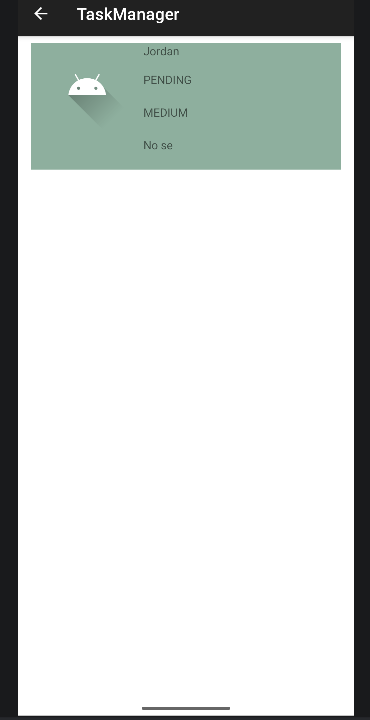

# Resolución de Práctica - TaskManager

**Estudiante:** Jordan  
**Asignatura:** Desarrollo de Aplicaciones Móviles  
**Proyecto:** TaskManager - Depuración y Solución de Errores  

---

## 🐞 Reporte de Errores Encontrados y Solucionados (Fase 0 - Debugging)

### 1. Error en Lanzamiento de `TaskListActivity` (Crash al presionar botón)
* **Descripción:** Al presionar el botón para abrir la lista de tareas (`btnTaskList_main`) en la pantalla principal (`MainActivity`), la aplicación se cerraba inesperadamente.
* **Diagnóstico (Logcat / Debugging):** Al revisar Logcat, se identificó una excepción `android.content.ActivityNotFoundException: Unable to find explicit activity class {cr.ac.utn.taskmanager/cr.ac.utn.taskmanager.TaskListActivity}`.
* **Causa:** La actividad `TaskListActivity` no estaba registrada en el archivo `AndroidManifest.xml`.
* **Solución:** Se agregó la declaración de la actividad dentro de la etiqueta `<application>` en `AndroidManifest.xml`:
  ```xml
  <activity
      android:name=".TaskListActivity"
      android:exported="false"
      android:windowSoftInputMode="adjustResize">
      <meta-data
          android:name="android.support.PARENT_ACTIVITY"
          android:value=".MainActivity" />
  </activity>
  ```

---

### 2. Error de Índice y Duplicación en `TaskListAdapter`
* **Descripción:** En la pantalla de lista de tareas, el primer y segundo elemento mostrados en el `RecyclerView` contenían la misma información, y la última tarea de la lista nunca se mostraba.
* **Diagnóstico (Debugging):** Se colocó un breakpoint en `onBindViewHolder` de `TaskListAdapter.kt` y se inspeccionó la variable `item`. Se encontró la siguiente condición errónea:
  ```kotlin
  val item = if (position > 0) tasks[position - 1] else tasks[position]
  ```
* **Causa:** Cuando la posición era mayor a 0, se restaba 1 al índice, provocando que la posición 1 leyera el elemento 0 nuevamente.
* **Solución:** Se corrigió el acceso a la lista utilizando el índice directo:
  ```kotlin
  val item = tasks[position]
  ```

---

### 3. Error de Parseo de Fechas en `util.kt`
* **Descripción:** Al intentar guardar o procesar fechas cuyo día fuera mayor a 12 (por ejemplo `25/03/2025`), la aplicación lanzaba un `NullPointerException` o fallaba al guardar.
* **Diagnóstico (Debugging):** Al seguir la ejecución en `TaskActivity` dentro del método `saveTask`, se detectó que `util.parseStringToDateModern` retornaba `null`. Al revisar `util.kt`, el formateador ignoraba el parámetro `pattern` recibido y tenía grabado en código fijo `"MM/dd/yyyy"`.
* **Causa:** Al pasar una fecha en formato `dd/MM/yyyy` (ej. `25/03/2025`), el formateador intentaba interpretar `25` como el mes, lo cual fallaba.
* **Solución:** Se actualizó `parseStringToDateModern` para que utilice el patrón enviado por parámetro:
  ```kotlin
  fun parseStringToDateModern(dateString: String, pattern: String): LocalDate? {
      return try {
          val formatter = DateTimeFormatter.ofPattern(pattern, Locale.getDefault())
          LocalDate.parse(dateString, formatter)
      } catch (e: Exception) {
          e.printStackTrace()
          null
      }
  }
  ```

---

### 4. Modo Edición Incorrecto en `cleanScreen()` de `TaskActivity`
* **Descripción:** Al presionar "Cancelar" o al limpiar la pantalla para ingresar una nueva tarea, el formulario quedaba configurado internamente en modo edición (`isEditMode = true`).
* **Diagnóstico (Debugging):** Al revisar `cleanScreen()`, se observó que la variable de estado `isEditMode` se asignaba explícitamente en `true`.
* **Causa:** Esto hacía que las operaciones posteriores asumieran que se estaba editando una tarea existente en lugar de registrar una nueva.
* **Solución:** Se corrigió el valor a `false` al limpiar la pantalla:
  ```kotlin
  private fun cleanScreen(){
      resetDate()
      isEditMode = false
      ...
  }
  ```

---

## 📷 Evidencias de Debugging

  
  

---

## 🚀 Resumen de Commits y PR
- **Rama creada:** `Jordan`
- **Estado:** Cambios commiteados y pusheados a `origin/Jordan`.
- **Pull Request:** Creado hacia la rama `main` en el repositorio original.
