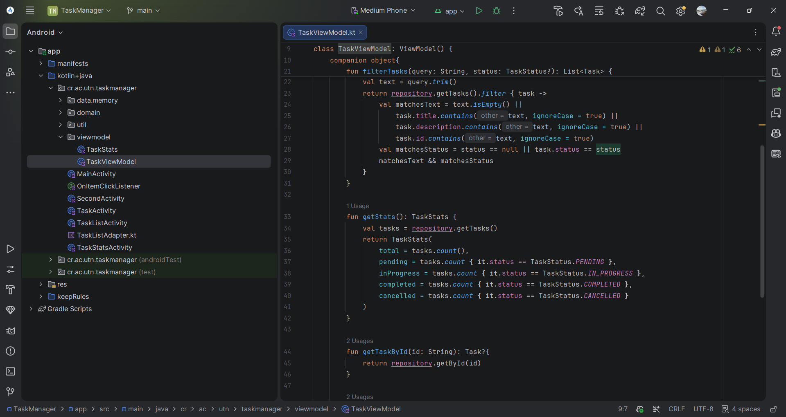
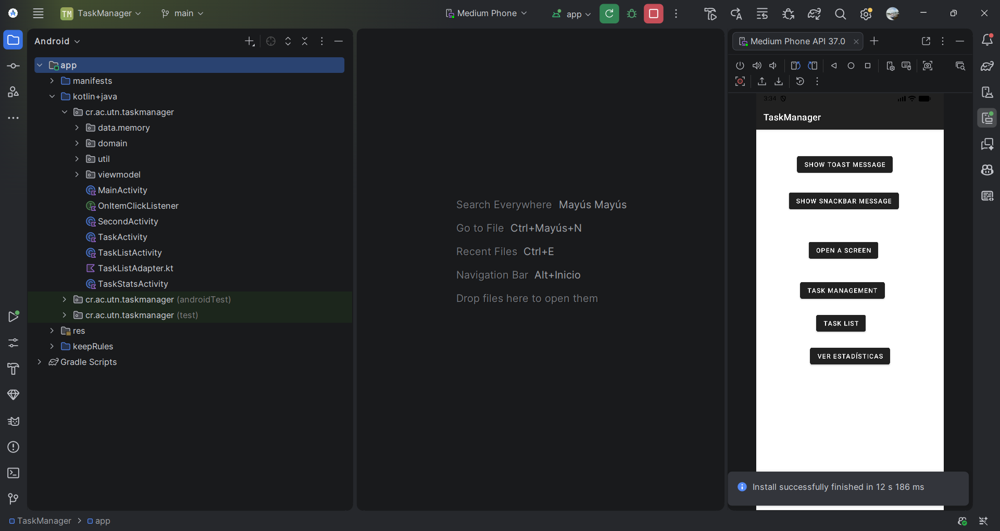
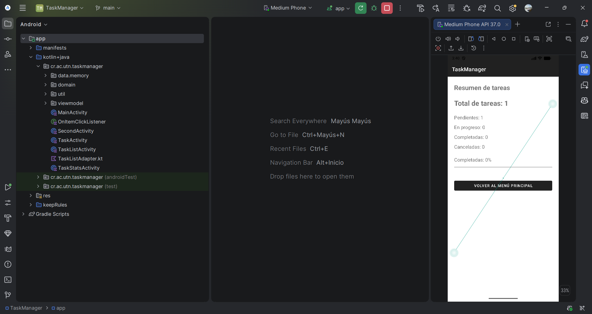
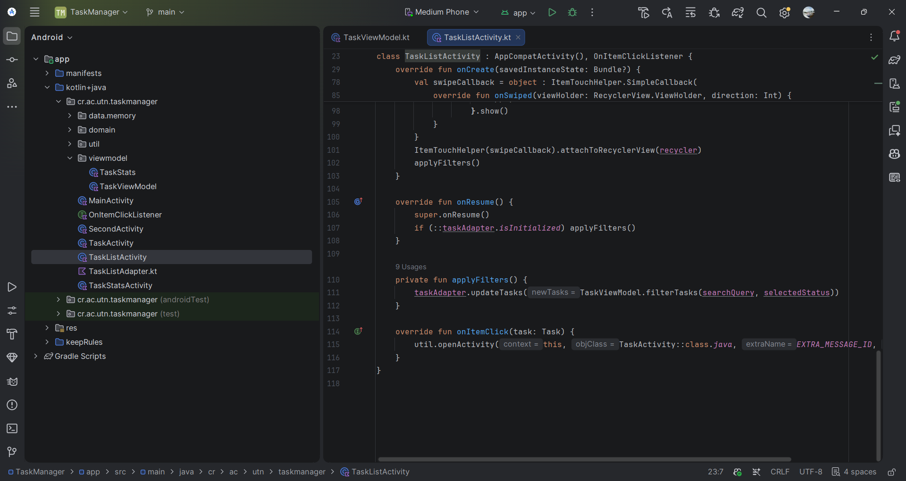
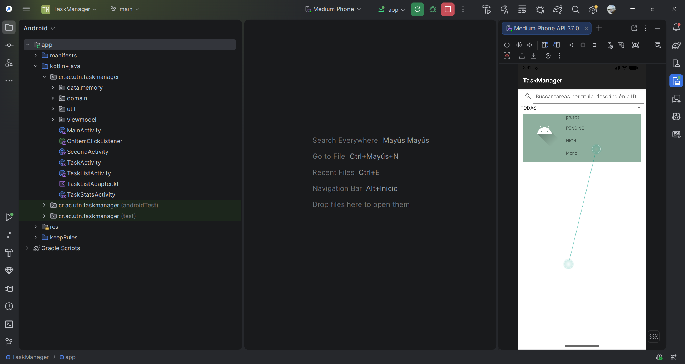
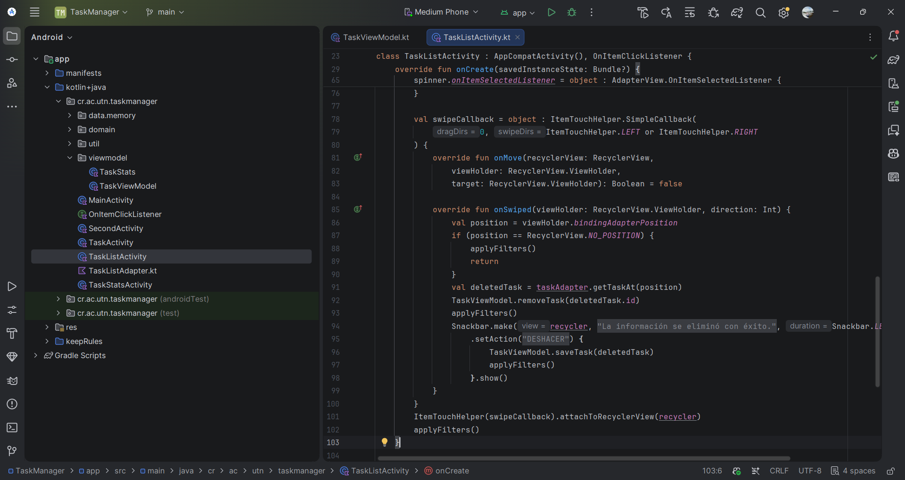
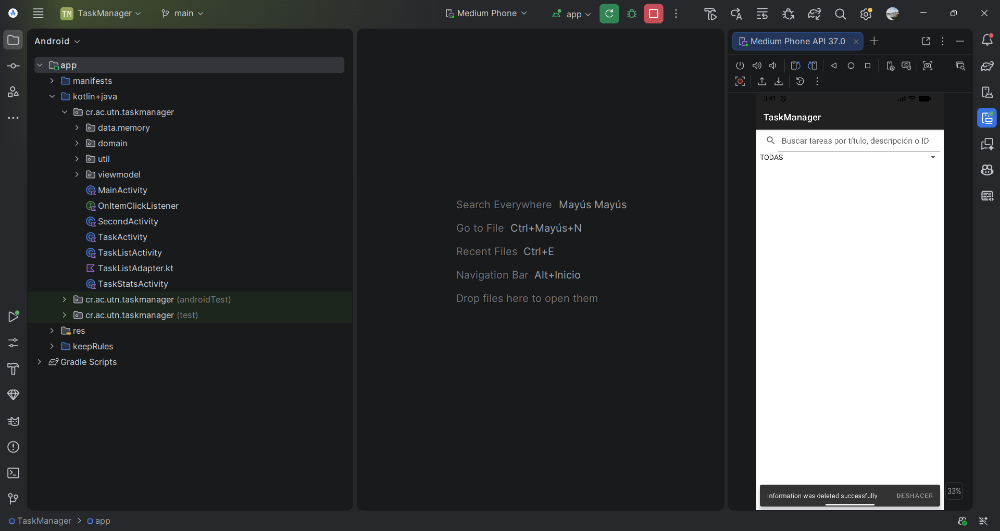

# Práctica TaskManager - Fases 1, 2 y 3

**Curso:** Desarrollo de Aplicaciones Móviles  
**Proyecto:** TaskManager  
**Rama de trabajo:** `practica-mario-espinoza`

En esta parte continué con el proyecto TaskManager después de corregir los errores de la fase 0. Agregué la pantalla de estadísticas, la búsqueda por tareas y la opción de eliminar deslizando.

## Fase 1. Estadísticas de tareas

Agregué `TaskStatsActivity` para ver cuántas tareas tengo registradas y cuántas hay por cada estado. En `TaskViewModel.kt` usé `count` para contar las tareas pendientes, en progreso, completadas y canceladas.

**Código para contar las tareas:**

También agregué el botón para abrir las estadísticas desde el menú principal.

La pantalla muestra el total, los estados y una barra que indica el porcentaje completado.

## Fase 2. Búsqueda y filtros

Agregué un buscador y una lista para escoger el estado de las tareas. La búsqueda permite encontrar tareas por título, descripción o ID. También puedo combinar el texto con el estado seleccionado.

En `TaskListActivity.kt` utilicé `applyFilters()` para actualizar la lista con los resultados.

Probé que aparecieran el buscador, el selector de estados y las tareas registradas. También comprobé el filtro combinado con tareas de diferentes estados.

## Fase 3. Eliminar una tarea deslizando

Agregué `ItemTouchHelper` para eliminar tareas al deslizarlas hacia un lado. Después de eliminar una tarea aparece un mensaje con la opción **DESHACER**, que permite recuperarla.

**Código de eliminación y restauración:**

**Prueba en el emulador:**

Probé la opción **DESHACER** y la tarea volvió a aparecer en la lista.

## Resultado

Ejecuté el proyecto en Android Studio y revisé las tres funciones. Las estadísticas mostraron los datos de las tareas, el buscador y los filtros funcionaron, y también pude eliminar y recuperar una tarea.

Las capturas de esta sección corresponden a las fases 1, 2 y 3. Las correcciones de los ocho errores de la fase 0 quedaron documentadas en la entrega anterior.
