# Depuración

## Error 1: No se podía guardar una tarea

Al presionar Guardar aparecía un mensaje "null" y la tarea no se guardaba. Puse un breakpoint en saveTask() y vi en el debugger que la variable dueDate (la fecha de vencimiento) quedaba en null.

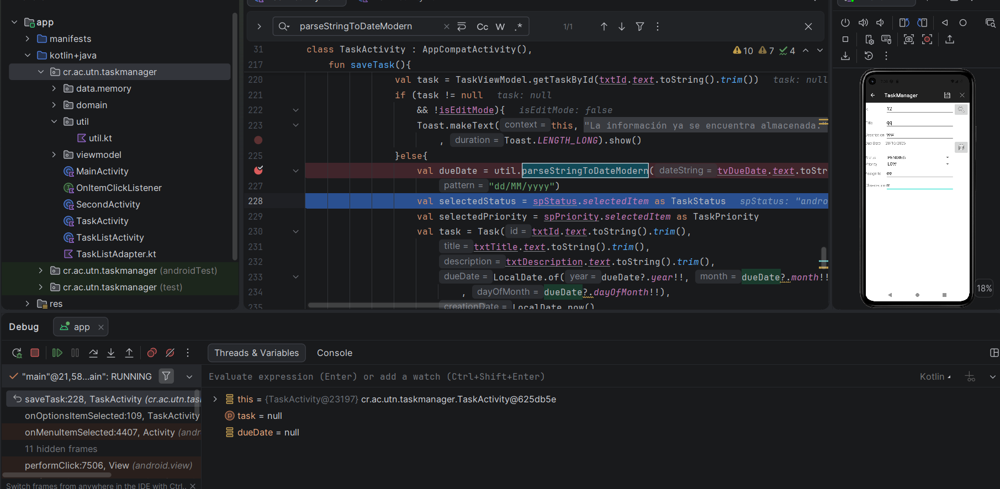

### Solución 1

Cambié el formato a "dd/MM/yyyy" para que coincida con cómo se muestra la fecha.

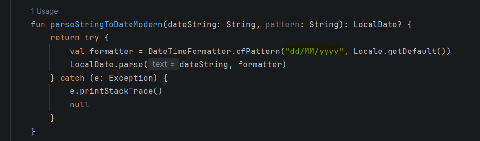

## Error 2: La fecha se mostraba con un mes menos

Puse un breakpoint en onDateSet(). Al elegir marzo, el debugger mostró month = 2.

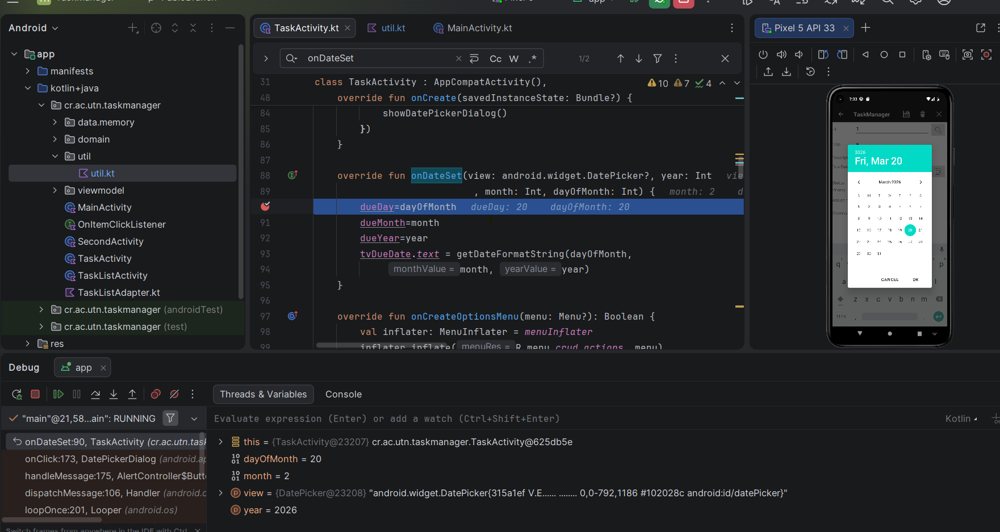

### Solución 2

Le sumé 1 al mes al mostrarlo: month + 1.

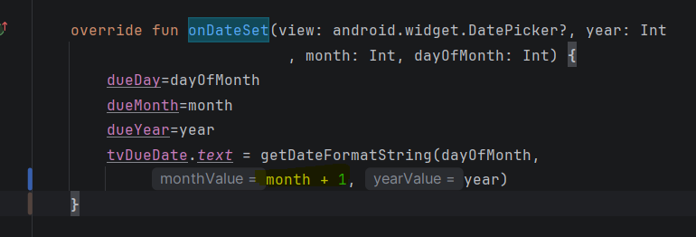

## Error 3: El botón eliminar seguía visible con el formulario vacío

Después de guardar o eliminar una tarea, el formulario se limpiaba, pero el botón eliminar seguía visible. Puse un breakpoint en cleanScreen() y el debugger mostró isEditMode: true con el formulario vacío.

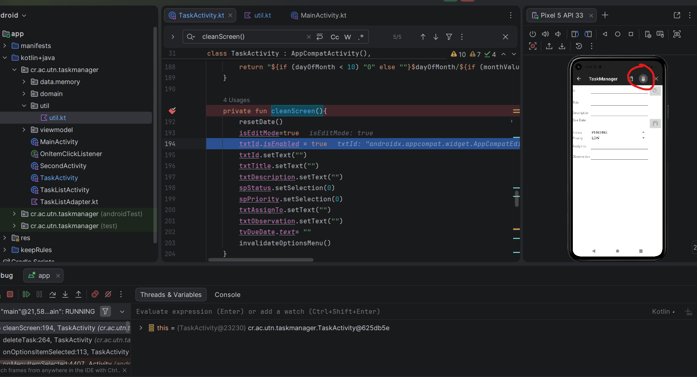

### Solución 3

Cambié a isEditMode = false.

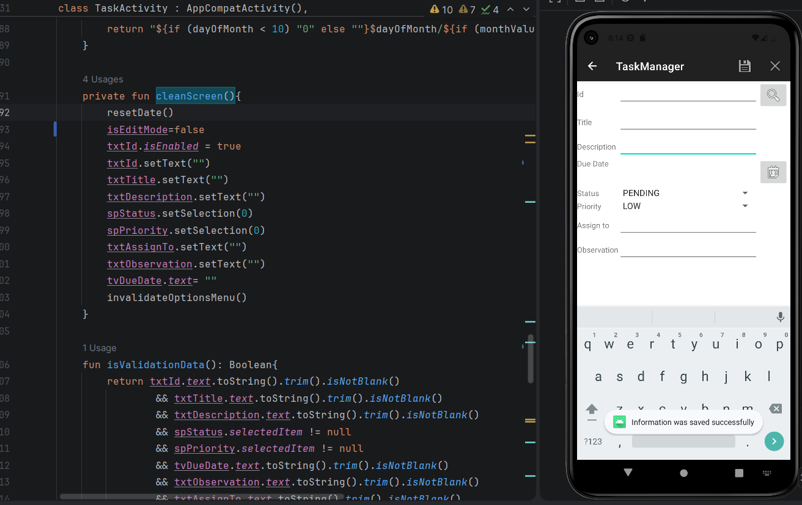

## Error 4: No pedía confirmación al actualizar o eliminar

Al actualizar o eliminar una tarea, la acción se hacía sin preguntar nada. Puse un breakpoint en saveTask() y vi que llegaba a guardar sin pedir confirmación.

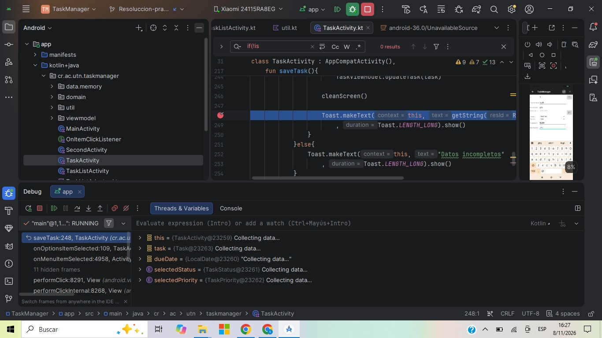

### Solución 4

Agregué una ventana que pregunta si quiero continuar o cancelar, tanto al actualizar como al eliminar.

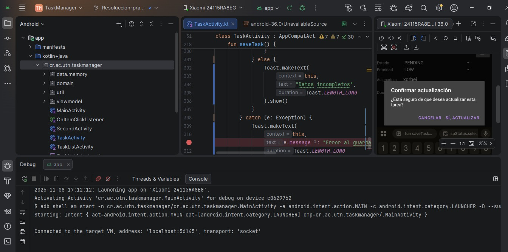

## Error 5: Al listar tareas, la aplicación se cerraba

Revisé AndroidManifest.xml y vi que faltaba declarar TaskListActivity.

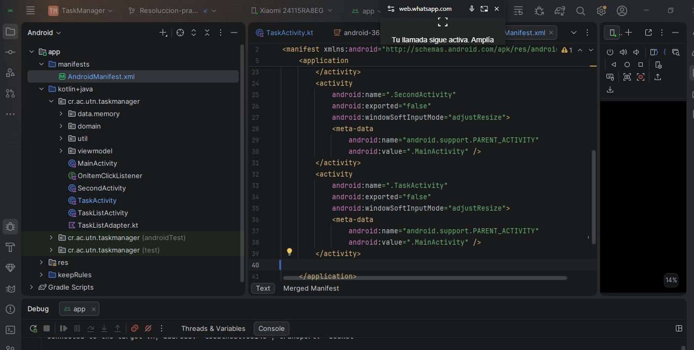

### Solución 5

Agregué TaskListActivity al manifest y ya funcionó.

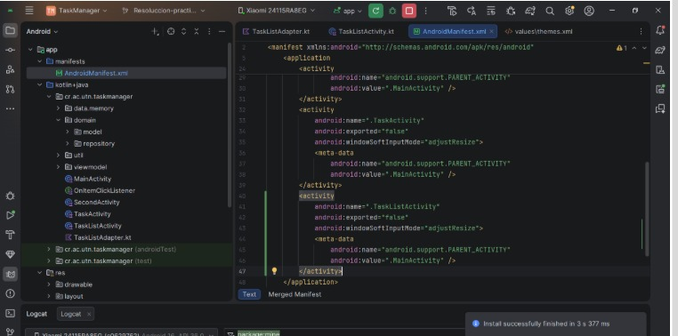

## Error 6: La lista repetía las tareas

Puse un breakpoint en onBindViewHolder() y encontré que se usaba position - 1, por eso repetía las tareas.

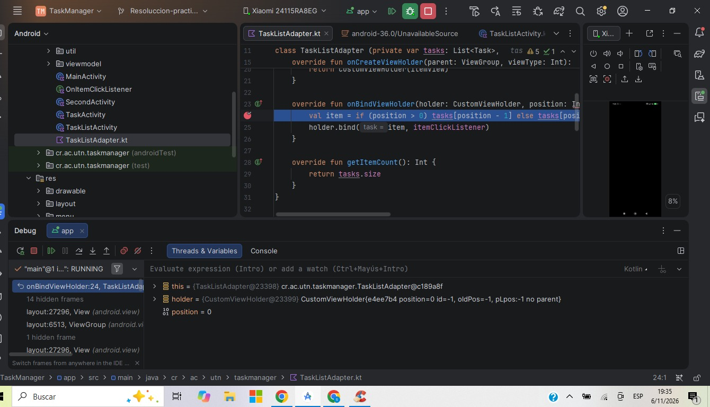

### Solución 6

Cambié la línea por tasks[position] y ya mostró las tareas bien.

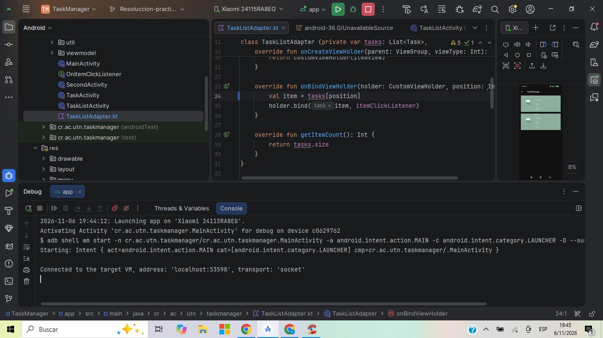

## Error 7: Al tocar una tarea, en el Id aparecía el título

Al tocar una tarea en la lista, en el campo Id aparecía el título, salía el mensaje "La información no existe" y el formulario quedaba sin datos. Puse un breakpoint en searchTask() y el debugger mostró id = "aa", que era el título de la tarea.

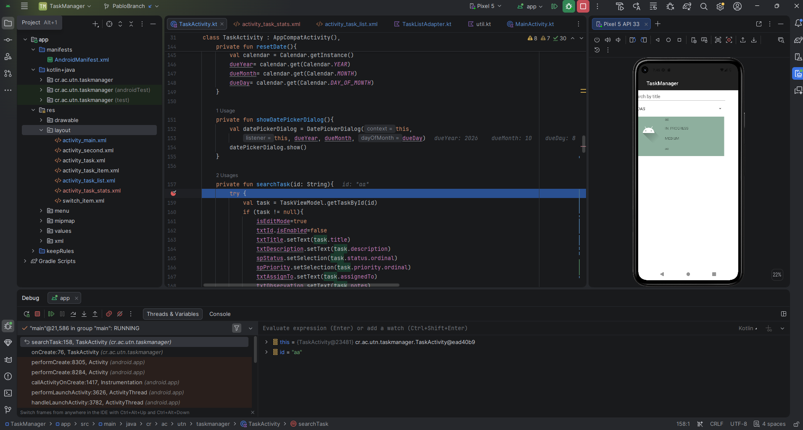

### Solución 7

En onItemClick() de TaskListActivity.kt cambié task.title por task.id.

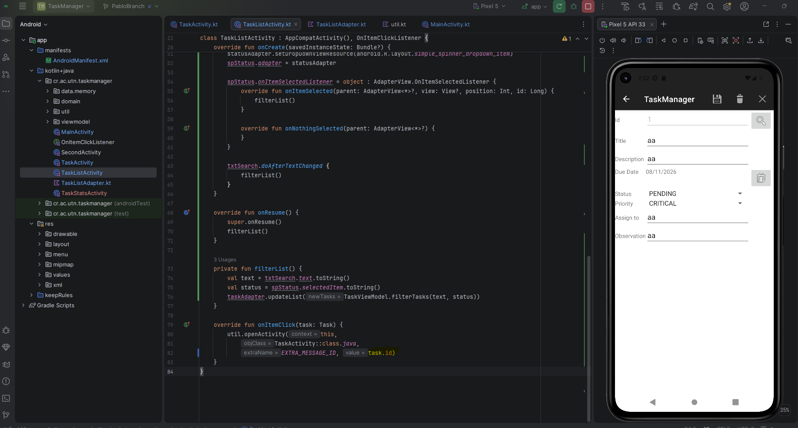

## Error 8: No se eliminaba una tarea buscada con espacios en el Id

Si buscaba una tarea escribiendo el Id con espacios, la encontraba, pero al eliminarla mostraba "eliminada con éxito" y la tarea seguía existiendo. Puse un breakpoint en deleteTask() y vi que, a diferencia de buscar y guardar, no usaba trim().

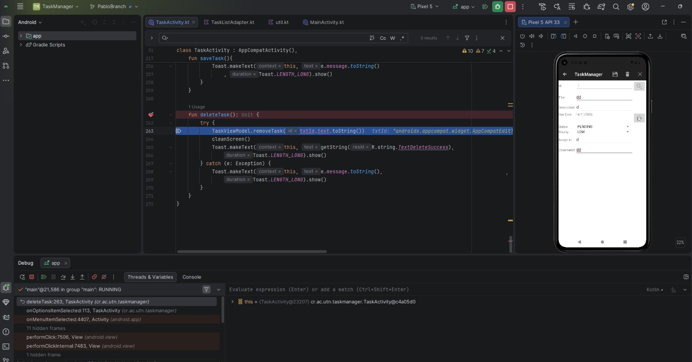

### Solución 8

Agregué .trim() en deleteTask().

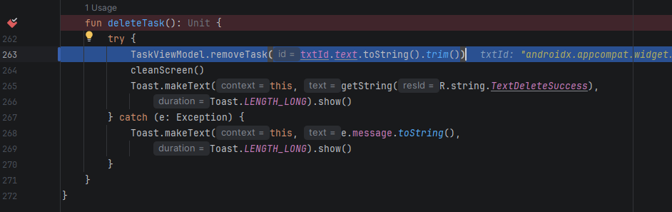
