# Resolución Práctica TaskManager - Diana Gómez Alvarado

## Fase 0: Depuración de errores

### Error 1: TaskListActivity no estaba en el Manifest
Al tocar "Task List" la app se cerraba. En Logcat apareció `ActivityNotFoundException`. Se registró `TaskListActivity` en `AndroidManifest.xml`.

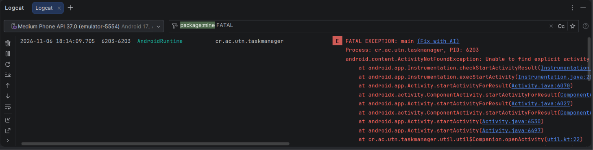

### Error 2: Se enviaba el título en vez del id
Al abrir una tarea desde la lista salía "La información no existe". Con un breakpoint en `onItemClick` vi que se enviaba `task.title`. Se cambió a `task.id`.

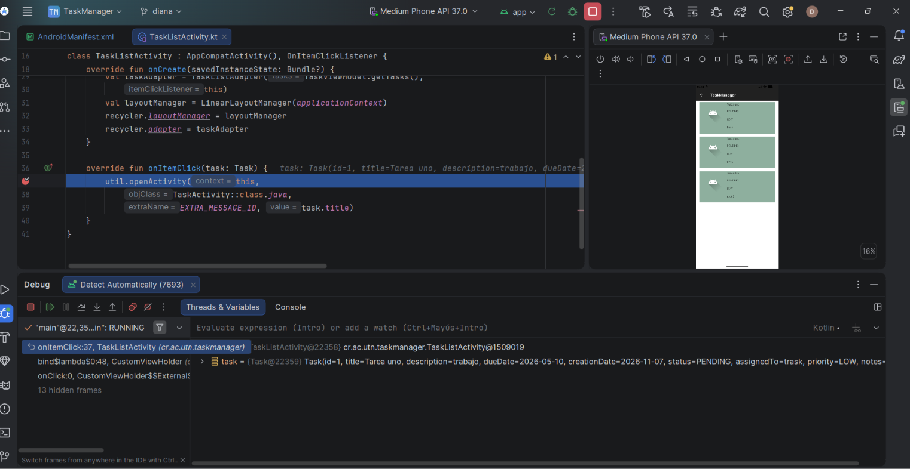

### Error 3: Posiciones incorrectas en el RecyclerView
La lista repetía la primera tarea y no mostraba la última. Con un breakpoint en `onBindViewHolder` vi que en `position = 1` se cargaba la Tarea uno por el `position - 1`. Se cambió a `tasks[position]`.

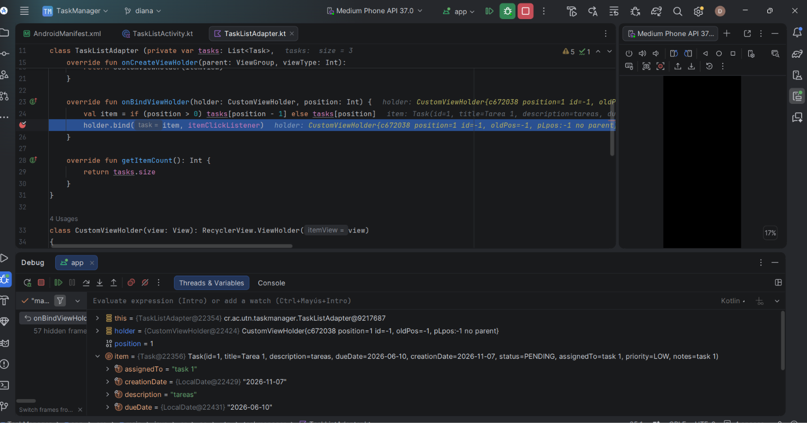

### Error 4: Error al convertir la fecha
Con días mayores a 12 la tarea no se guardaba. En Logcat salió `DateTimeParseException: Invalid value for MonthOfYear`, porque `parseStringToDateModern` usaba fijo `"MM/dd/yyyy"` e ignoraba el parámetro `pattern`. Se cambió a `ofPattern(pattern)`.

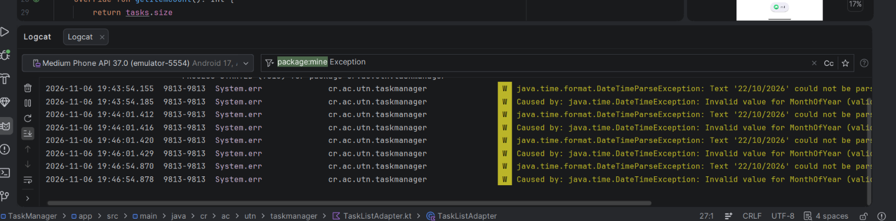

### Error 5: Modo edición al limpiar el formulario
Después de guardar, las tareas nuevas se trataban como edición y no se detectaban duplicados. Con un breakpoint en `cleanScreen` vi que ponía `isEditMode = true`. Se cambió a `false`.

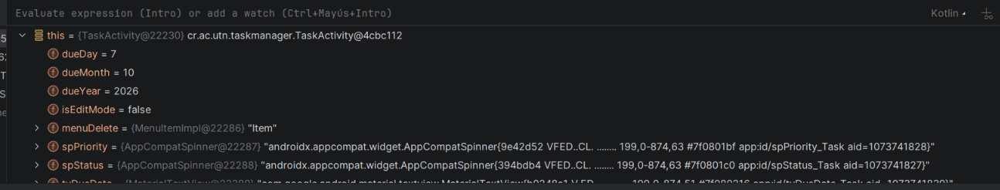

### Error 6: Mes incorrecto en la fecha
La fecha elegida salía un mes atrás. Con un breakpoint en `onDateSet` vi que el DatePicker entrega el mes desde 0 (noviembre = 10). Se le sumó 1 al mostrarlo y se le restó 1 en `searchTask` para abrir el calendario en el mes correcto.

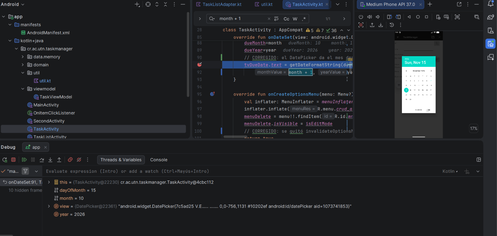

### Error 7: El menú se recargaba sin parar
`onCreateOptionsMenu` llamaba a `invalidateOptionsMenu()`, que vuelve a ejecutar `onCreateOptionsMenu` y crea un ciclo. Con un breakpoint vi que se ejecutaba una y otra vez. Se quitó esa llamada.

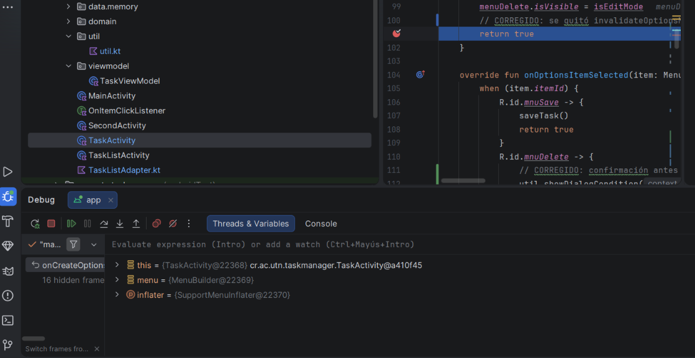

### Error 8: Faltaba confirmación al actualizar y eliminar
Se usó `util.showDialogCondition` para mostrar un diálogo Sí/No antes de actualizar y antes de eliminar una tarea.

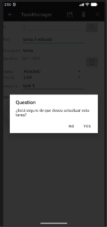

## Fase 1: Pantalla de estadísticas
Se creó `TaskStatsActivity` con `activity_task_stats.xml`. Muestra el total de tareas, el conteo por estado (PENDING, IN_PROGRESS, COMPLETED y CANCELLED) y una barra de progreso con el porcentaje de tareas completadas. Los cálculos están en `TaskViewModel` usando `count` y `filter`. Se abre desde el botón "Estadísticas" de `MainActivity` mediante un Intent, y el botón "Volver" regresa al menú principal.

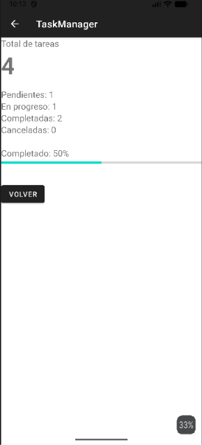

## Fase 2: Búsqueda dinámica y filtros por estado
En `activity_task_list.xml` se agregaron un `SearchView` y un `Spinner` con las opciones TODAS, PENDING, IN_PROGRESS, COMPLETED y CANCELLED. El método `TaskViewModel.filterTasks(texto, estado)` combina ambos filtros, y la lista se actualiza en tiempo real con `updateList` del adapter.

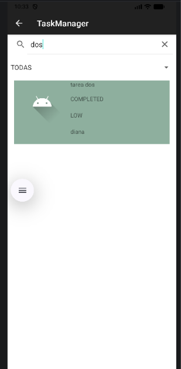
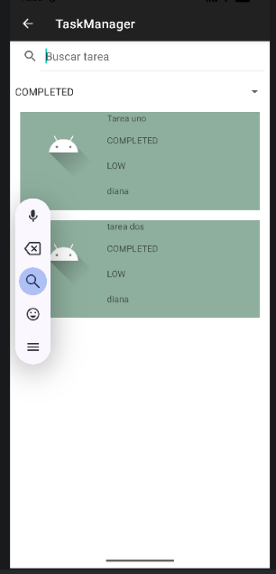
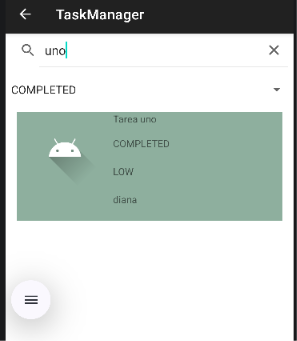

## Fase 3: Eliminar tareas con gestos y deshacer
Se implementó `ItemTouchHelper.SimpleCallback` en el RecyclerView de `TaskListActivity`. Al deslizar una tarea se elimina y aparece un Snackbar con la opción DESHACER, que restaura la tarea.

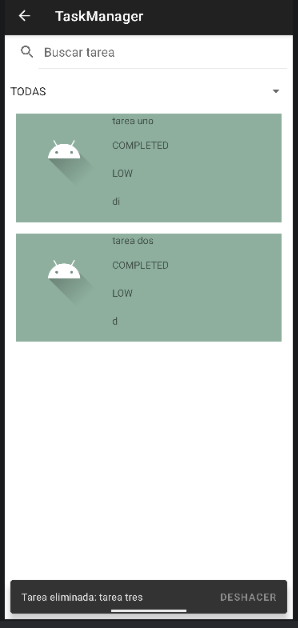
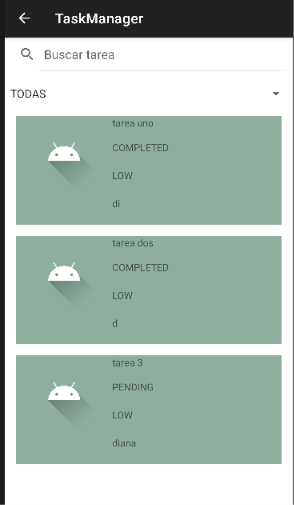
