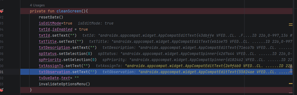
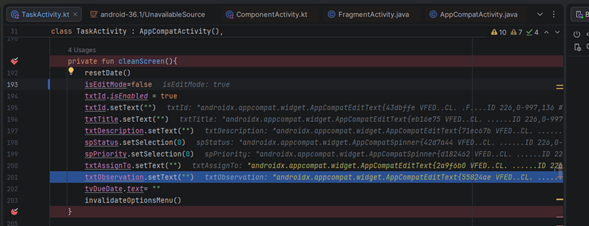
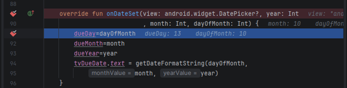
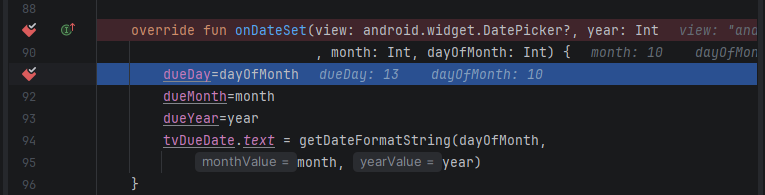
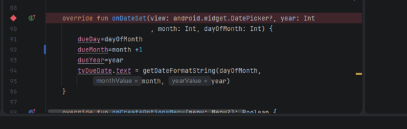
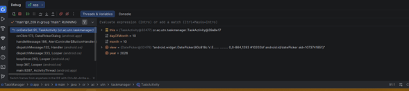
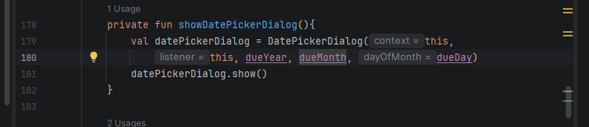
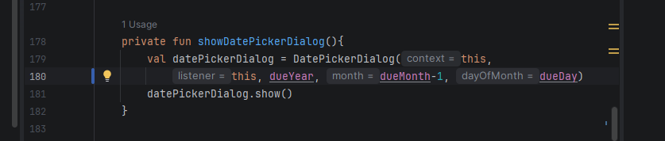
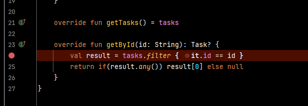
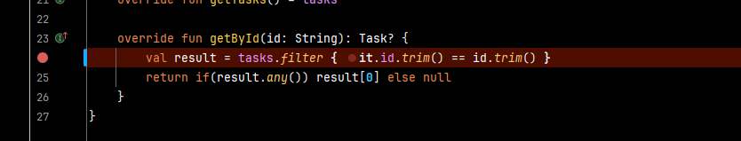

# Errores encontrados

**Estudiantes:** Nailea Soto y María Murillo Chaves

## Fase 0: Identificación y corrección de errores

### Error 1: Corrección del modo de edición en TaskActivity.kt

**Archivo:** `TaskActivity.kt`  
**Método:** `cleanScreen()`

#### Descripción del problema

Durante la revisión del archivo `TaskActivity.kt`, se identificó una inconsistencia en la variable `isEditMode` dentro de la función `cleanScreen()`.

La variable se estaba estableciendo con el valor `true` al limpiar el formulario, provocando que la aplicación pudiera continuar trabajando en modo edición, aunque la intención fuera registrar una tarea nueva.

#### Identificación mediante Debug

Se ejecutó la aplicación en modo Debug y se colocó un breakpoint en la función `cleanScreen()`.

**Evidencia 1: Identificación del problema en Debug.**

**Evidencia 2: Estado del error en el código.**

#### Solución aplicada

Se modificó la función `cleanScreen()` para establecer `isEditMode = false`, permitiendo desactivar el modo de edición al limpiar el formulario.

**Evidencia 3: Solución aplicada.**

#### Resultado esperado

Al limpiar el formulario, la aplicación queda preparada para registrar una nueva tarea, evitando que se mantenga activo el estado de edición de una tarea anterior.

### Error 2: Corrección en el manejo de fechas (Mes incorrecto en `onDateSet`)

**Archivo:** `TaskActivity.kt`  
**Método:** `onDateSet()`, `resetDate()`, y `showDatePickerDialog()`

#### Descripción del problema

Durante la selección de la fecha de vencimiento de la tarea, se identificó que en el método `onDateSet()` se utilizaba el valor del mes (`month`) recibido del `DatePickerDialog` sin sumarle `1`. 

Dado que la clase `DatePicker` y el calendario en Java/Android empiezan a contar los meses desde `0` (donde `0` es Enero y `11` es Diciembre), al omitir la suma de `1`, la fecha mostrada en la interfaz (`tvDueDate`) y procesada por la aplicación quedaba desfasada por un mes.

#### Identificación del error

**Evidencia 1:**  

**Evidencia 2:**  

#### Solución aplicada

Se modificó el método `onDateSet()` para sumar `1` al recibido (`month + 1`) tanto al actualizar la variable `dueMonth` como al invocar `getDateFormatString()`. Asimismo, se ajustó la inicialización en `resetDate()` y el paso de parámetros en `showDatePickerDialog()` (`dueMonth - 1`) para mantener una sincronización correcta entre el índice base 0 del componente visual y el valor de mes de 1 a 12.

**Evidencia 3 (Solución):**  

#### Resultado

Se corrigió exitosamente el cálculo del mes, garantizando que al seleccionar una fecha mediante el calendario, esta se muestre y guarde con el mes correcto en la aplicación.

### Error 3: Calendario desfasado al buscar tareas (`searchTask`)

**Archivo:** `TaskActivity.kt`  
**Método:** `searchTask()`

#### Descripción del problema

En el método `searchTask()`, al buscar y cargar una tarea existente para editarla, se asignaba `dueMonth = task.dueDate.monthValue`. 

Sin embargo, `task.dueDate.monthValue` devuelve un mes en rango de `1` a `12`, mientras que el componente `DatePickerDialog` espera que el mes se encuentre entre `0` y `11`. Esto provocaba un desfase en el calendario al abrir el selector de fechas para una tarea ya guardada.

#### Identificación del error

**Evidencia 1:**  

**Evidencia 2:**  

#### Solución aplicada

Se ajustó la asignación en `searchTask()` realizando la resta correspondiente (`dueMonth = task.dueDate.monthValue - 1`) para que el selector de fechas reciba un valor entre `0` y `11`.

**Evidencia 3 (Solución):**  

#### Resultado

Se corrigió el desfase del calendario al editar tareas existentes, sincronizando correctamente el mes entre los datos y el selector visual.

### Error 4: Problema con los ID en TaskMemoryManager (`getById` y `deleteTask`)

**Archivo:** `TaskMemoryManager.kt`  
**Métodos:** `getById()` y `deleteTask()`

#### Descripción del problema

Los métodos `getById()` y `deleteTask()` realizaban la comparación de identificadores de tareas (`it.id == id`) de manera exacta sin utilizar `.trim()`. 

Esto podía provocar fallos o que la aplicación no encontrara ni eliminara correctamente una tarea si el ID contenía espacios en blanco accidentales al inicio o al final.

#### Identificación del error

**Evidencia 1:**  

#### Solución aplicada

Se actualizaron los métodos `getById()` y `deleteTask()` en `TaskMemoryManager.kt` para comparar los identificadores aplicando `.trim()` en ambos extremos (`it.id.trim() == id.trim()`), asegurando una búsqueda y eliminación robustas.

**Evidencia 2 (Solución):**  

#### Resultado

Se solucionó el problema de coincidencia de identificadores, garantizando que los espacios en blanco accidentales no afecten la búsqueda ni la eliminación de tareas en memoria.
