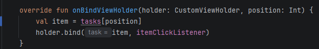

# TaskManager – Errores encontrados y soluciones

Práctica de corrección de errores en la aplicación Android **TaskManager**.

---

## Error #1: Fecha atrasada un mes

**Problema:** el mes se mostraba incorrectamente porque no se sumaba 1 al formatear la fecha. El `DatePickerDialog` entrega el mes en base 0 (enero = 0).

**Antes (error):**

**Solución:**
- En la clase `util`, la función `parseStringToDateModern` tenía el formato hardcodeado (`"MM/dd/yyyy"`). Ahora usa el parámetro `pattern`.
- En `TaskActivity`, en la función `onDateSet`, al llamar a `getDateFormatString` se le suma `+1` al mes.

**Después (corregido):**

---

## Error #2: La aplicación se cierra al abrir la lista de tareas

**Problema:** al tocar el botón *Listar tareas* en la pantalla principal, la aplicación se cerraba.

**Antes (error):**

**Solución:** revisando el `AndroidManifest.xml`, la clase `TaskListActivity` no estaba declarada. Se agregó al manifest.

**Después (corregido):**

---

## Error #3: El calendario abre un mes adelantado al modificar la fecha

**Problema:** al guardar una tarea, buscarla por id y querer modificar la fecha, el calendario aparecía por defecto un mes adelantado. Al cargar los datos, la fecha sí se mostraba bien.

**Antes (error):**

**Solución:** en la función `searchTask` de la clase `TaskActivity`, restar 1 a `dueMonth` (`task.dueDate.monthValue - 1`), porque el `DatePickerDialog` usa meses de 0 a 11.

**Después (corregido):**

---

## Error #4: Se enviaba el título en lugar del id al abrir una tarea

**Problema:** en la lista de tareas, al hacer clic en una tarea, el título se cargaba en el campo de id de la pantalla de gestión.

**Antes (error):**

**Solución:** en la función `onItemClick` de `TaskListActivity`, cambiar el valor enviado en `util.openActivity` de `task.title` a `task.id`.

**Después (corregido):**

---

## Error #5: La lista mostraba la primera tarea repetida

**Problema:** al guardar varias tareas, la lista mostraba la tarea 1 con sus datos correctos y la segunda también mostraba los datos de la tarea 1.

**Antes (error):**

**Solución:** en `TaskListAdapter.onBindViewHolder`, mostrar los datos únicamente según la posición: `val item = tasks[position]`.

**Después (corregido):**

---

## Error #6: Se podía sobrescribir una tarea con un id ya existente

**Problema:** después de usar *cleanScreen* (guardar o cancelar), la aplicación permitía guardar una tarea con un id ya existente, sobrescribiendo los datos sin avisar.

**Antes (error):**

**Solución:** en la función `cleanScreen` de `TaskActivity`, cambiar `isEditMode = true` por `isEditMode = false`, para que se valide si ya existe una tarea con ese id.

**Después (corregido):**

---

## Error #7: *(pendiente)*

**Problema:** *(describir)*

**Antes (error):**

📷 *[Pegar captura aquí]*

**Solución:** *(describir)*

**Después (corregido):**

📷 *[Pegar captura aquí]*

---

## Error #8: *(pendiente)*

**Problema:** *(describir)*

**Antes (error):**

📷 *[Pegar captura aquí]*

**Solución:** *(describir)*

**Después (corregido):**

📷 *[Pegar captura aquí]*