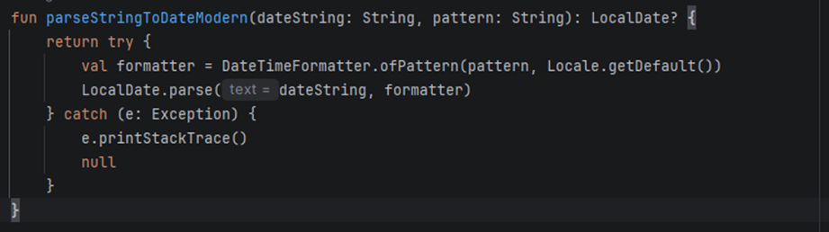
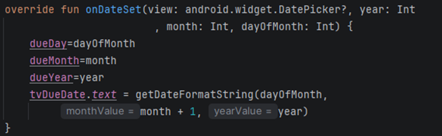
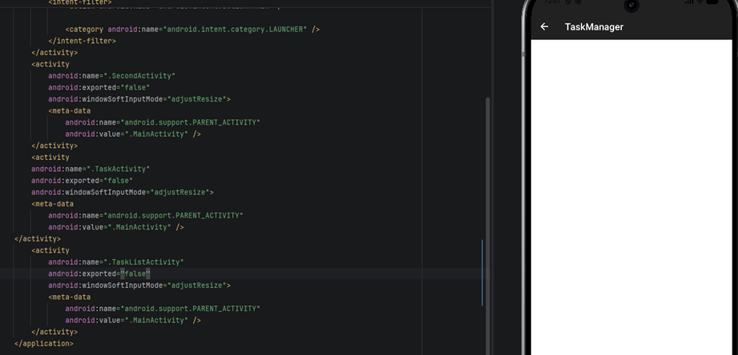
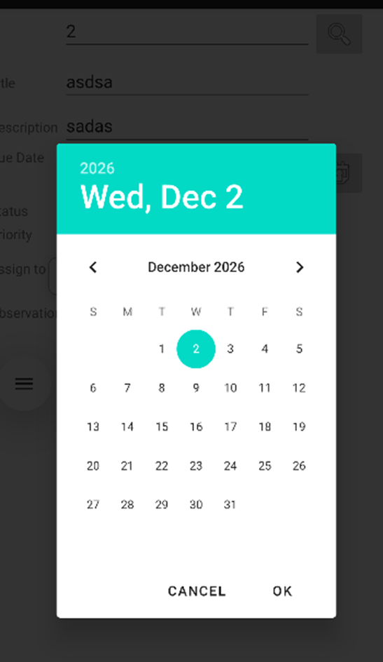
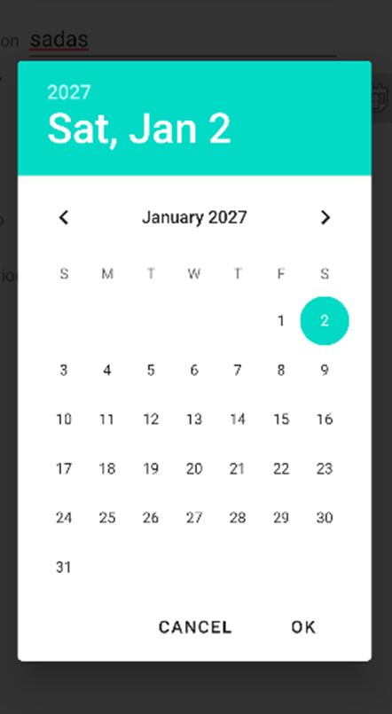
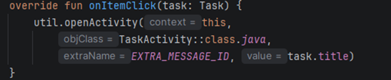
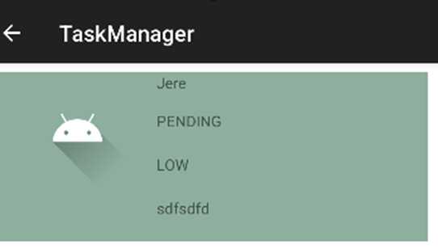
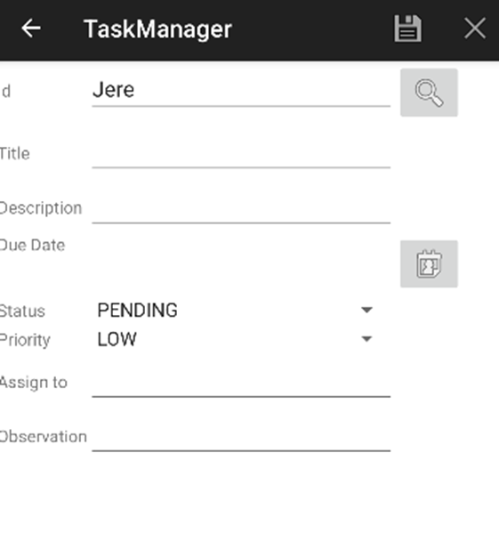
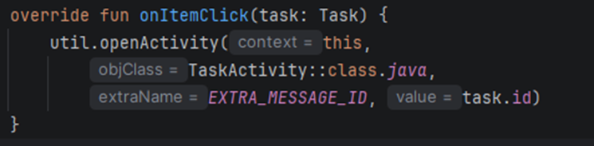
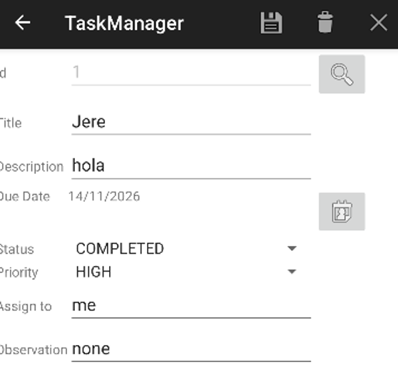

# Errores encontrados en el Lab

Resolución de la práctica — Jeremy Delgado.

---

## Error 1

**Problema:** Fecha atrasada un mes. El mes se mostraba incorrectamente porque no se estaba sumando 1 al formatear la fecha. Además, `parseStringToDateModern` ignoraba el parámetro `pattern` y utilizaba un formato fijo.

**Solución:** Se cambió el formato fijo de la fecha para que reciba el parámetro `pattern`. En la función `onDateSet`, dentro de su función interna `getDateFormatString`, al parámetro `monthValue` se le añadió un `+ 1` para que indique el mes correcto.

---

## Error 2

**Problema:** `TaskListActivity` se cerraba porque no estaba declarado en el manifest.

**Solución:**

---

## Error 3

**Problema:** Al guardar una task y buscarla con el id, al modificar su campo fecha el calendario inicia en enero o un mes adelantado, y no en su mes guardado.

**Solución:** Añadir un `-1` a la variable `dueMonth` en la función `searchTask` de la clase `TaskActivity`.

---

## Error 4

**Problema:** Al abrir una tarea desde `TaskListActivity` se enviaba el `title` en lugar del `id` de la Task.

**Solución:** Enviar el `id`, para que `TaskManager` encuentre la Task y su data.

---

## Error 5

**Problema:** Al guardar las tareas, en `TaskList` se mostraba la Task 1 con sus datos correctos, pero la segunda también mostraba los datos de la Task 1.

**Solución:** Mostrar los datos solo por la posición.

![Código: onBindViewHolder con val item = tasks[position]](img/error-5-codigo-solucion.png)

---

## Error 6

**Problema:** En `TaskActivity`, la función `cleanScreen` deja activado el modo de edición. Después del clear screen (que ocurre al presionar el botón X) se puede guardar una Task nueva con un id ya existente.

**Solución:** Cambiar el valor de la variable `isEditMode` por `false` para que entre a validar si ya existe una tarea con ese id.

---

## Error 7

**Problema:**

**Solución:**

---

## Error 8

**Problema:**

**Solución:**

