# Práctica en clases semana 8

**Profesor:** Ever Barahona Mendoza

**Estudiante**: Yordi Contreras Zamora

**Asignatura:** Desarrollo de Aplicaciones para Dispositivos Móviles

## Errores y correcciones del código TaskManager

### Error 1

Atraso en horario

Fecha atrasada un mes, el mes se digitaba en noviembre y aparecia número
de mes de octubre.

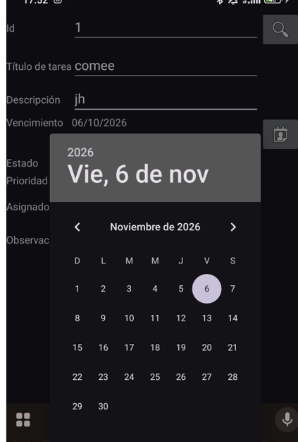

Lo guarda en octubre, lo cual es incorrecto, se debe formatear en el mes
que se indica.

**Solución**: Cambio en la función OnDateSet donde se incrementa uno más
al mes y en util, en el método parseStringToDateMordern donde se cambia
el código hardcodeado y se pone el pattern:

Evidencias: En esta sección se le incluye un + al mes en OnDateSet

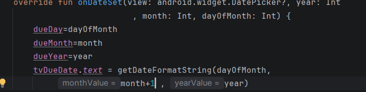

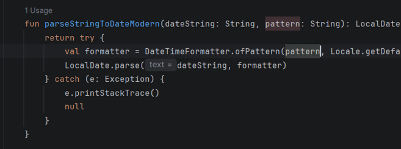

**Solución**:

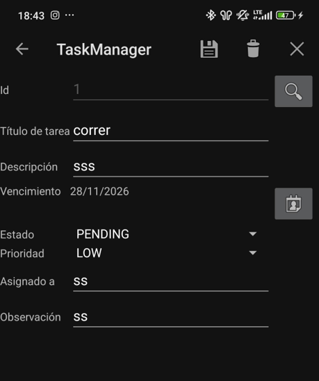

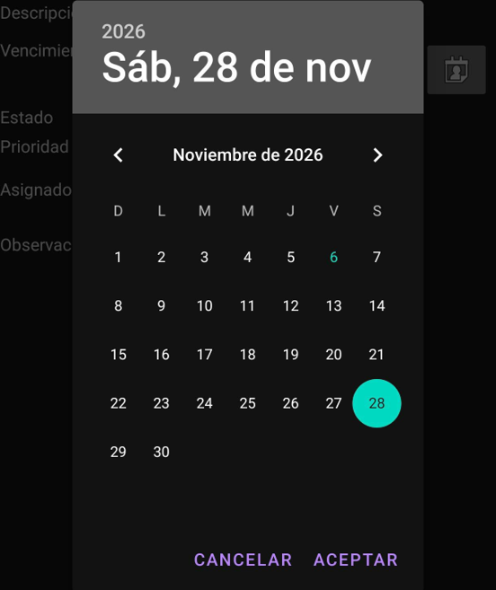

### Error 2

No se muestra el tasklist en la app, debido a que el error está en el
manifest que no llama la actividad

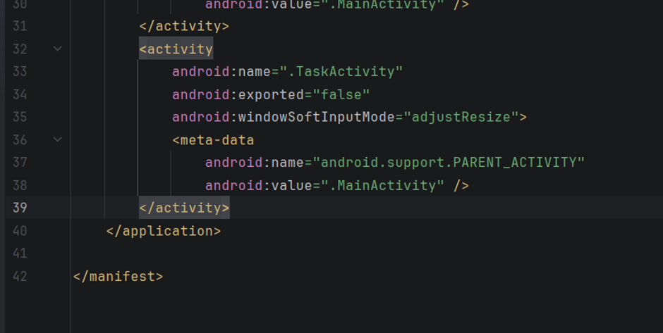

**Solución**: se agrega una nueva actividad donde se incluye
.TaskListActivity:

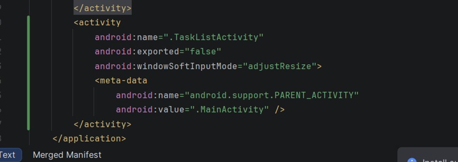

Evidencia de la lista funcionando:

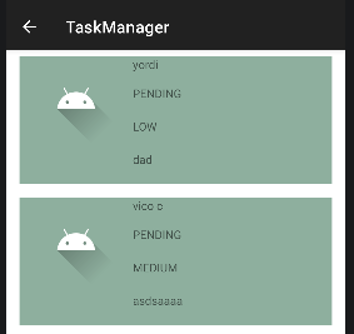

### Error 3

Al guardar una tarea y buscarla, inicia en un mes adelantado.

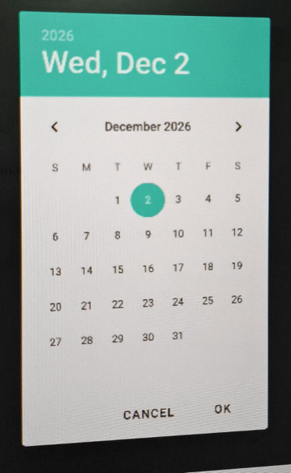

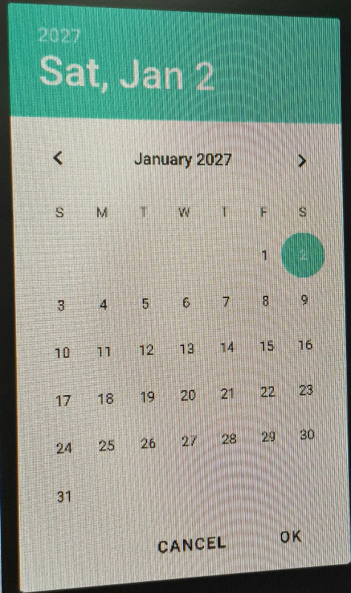

**Solución**

Añadir un -1 a dueMonth en la función searchTask en TaskActivity:

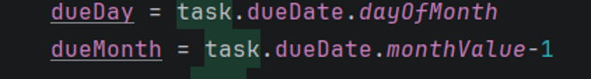

### Error 4

Abrir una tarea desde la lista de tareas y se envía un tittle en vez del
id de la tarea:

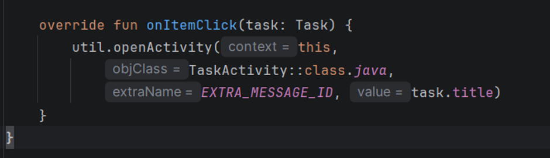

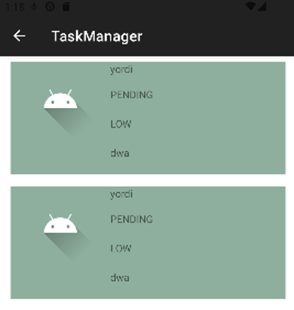

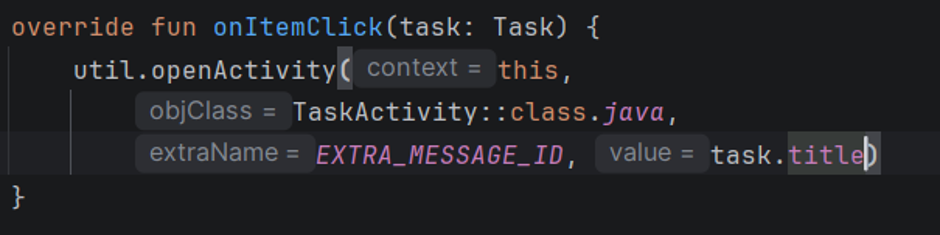

**Solución:**

En el value se quita el task.title y se sustituye por id.

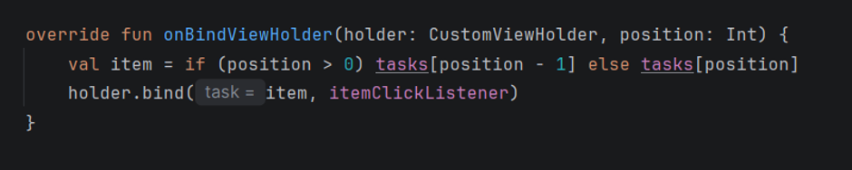

### Error 5

Al guardar las tareas en la lista se mostraba el 1 con la información
correcta y la segunda tarea mostraba los de la tarea 1.

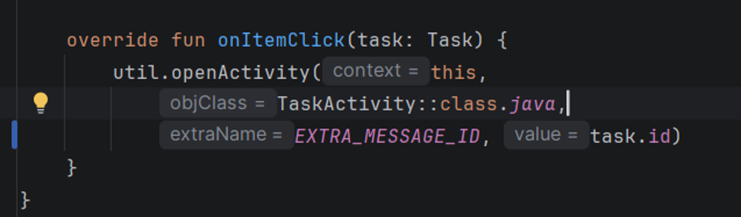

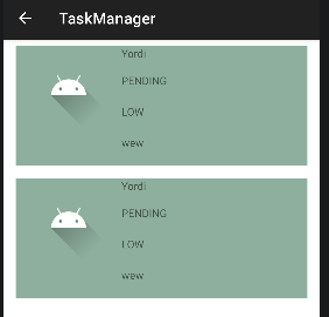

**Solución:**

En este método se quita la condicional y el vector(position-1):

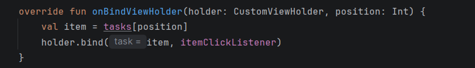

Resultado, datos listados y lista de tarjetas bien formateadas y
ordenadas.

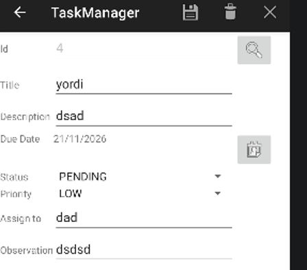

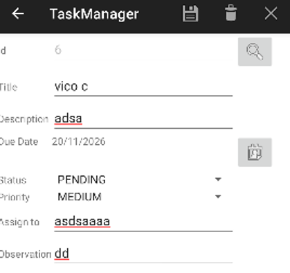

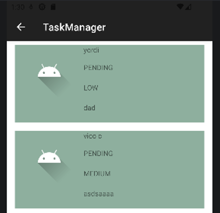

### Error 6

La función de limpiar pantalla de TaskManager, su función clearScreen
tiene el modo de edición activo: Lo que pasa despues del clean screen de
guardar una tarea, se puede almacenar una tarea nueva con un id
existente

**Solución**: cambiar el valor de isEditMode a verdadero para evitar la
redundancia de id

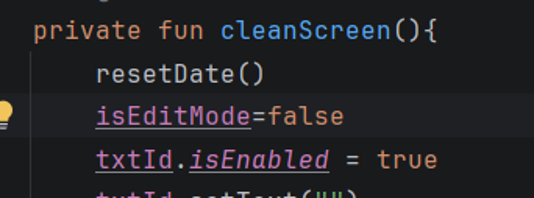

**Id 1 ya existente:**
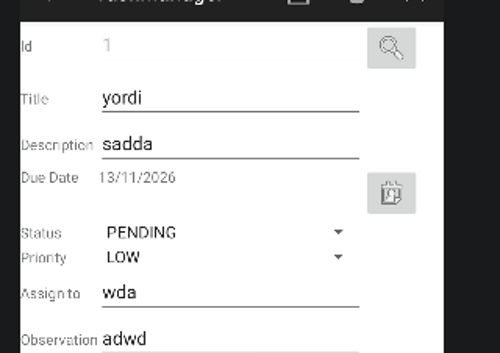

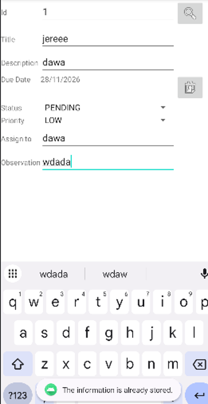

### Error 7

### Error 8